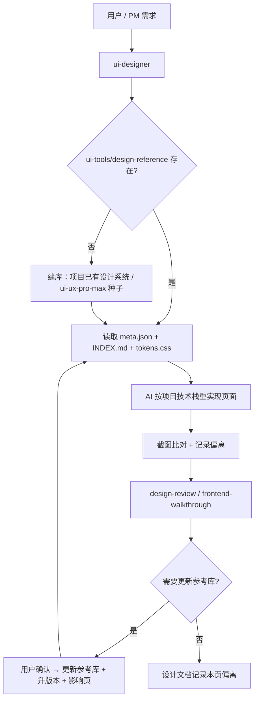

# 技能视觉参考库改造方案

> 需求 ID：REQ-20261023-001
> 状态：设计中（未实施）
> 日期：2026-10-23
> 范围：ui-designer / design-review / frontend-walkthrough / code-review（交接单）
> 前置依赖：`skill-install.sh --no-record`（已实现，commit `5ba5cd8`）

---

## 0. 摘要

本方案把 `ui-designer` 原先“在设计文档里存一份设计系统快照”的做法，替换为**项目级视觉参考库（Visual Reference Library）**：

- 参考库固定在项目工作区 `ui-tools/design-reference/`，不在任何 IDE 会扫描的 skill 目录；
- 参考库由 **tokens.css + 组件参考 HTML + 组件规格 + INDEX.md + meta.json** 组成；
- 组件参考 HTML 只做**视觉参考**，不是生产组件；应用时由 AI 按项目技术栈重新实现；
- 建库支持三种模式：已有设计系统镜像 / 已有页面但无设计系统时提取基线 / 新项目由 ui-ux-pro-max 生成种子；
- 修改组件公共视觉时，必须经过「只改本页 / 更新参考库 / 更新参考库并同步使用页」三选一确认；
- 设计文档不再存整份 token 快照，只记录**参考库版本 + 本页偏离**。

一句话：**参考库是视觉契约，不是代码来源；是项目资产，不是 skill 附属物。**

---

## 1. 背景与问题

### 1.1 现状

`ui-designer` 目前产出：

- `docs/ui-design/{slug}.md`：界面布局方案文档；
- `demo/{slug}/index.html`：单页 demo；
- 视觉 token 以文字/表格形式写在方案文档里。

`design-review`、`frontend-walkthrough` 目前主要依据方案文档与页面自身做评审，没有一份**跨页面可复用的视觉基线**。

### 1.2 问题

| 问题 | 表现 |
|---|---|
| 视觉决策不可复用 | 每个页面重新定色板、字阶、按钮状态，页面之间容易漂移 |
| doc 快照不可执行 | token 写在 Markdown 里，AI 仍要“翻译”为 CSS；无法截图对比 |
| 用户调整无法沉淀 | 用户改过的按钮/卡片样式只留在当前页，下一页又回到默认 |
| 评审缺基线 | design-review 只能看“是否符合文档”，无法看“是否偏离项目既有视觉” |
| 外部知识一次性 | ui-ux-pro-max 每次生成建议，但没有落到项目可复用资产 |

### 1.3 为什么不是“生产组件库”

本方案明确选择**视觉参考**，不做法定生产组件库：

- 项目技术栈不确定（React / Vue / 原生 / 桌面端），生产组件必须绑定栈；
- 生产组件需要构建、依赖、版本管理，超出 skill 的能力边界；
- AI 生成场景更常见的是“按参考重新实现”，而不是“import 一个组件”；
- 参考库可以跨栈复用；生产组件库不能。

---

## 2. 目标与非目标

### 2.1 目标

| # | 目标 |
|---|---|
| G1 | 每个项目有一份自己的、可复用的视觉参考库 |
| G2 | AI 能通过 INDEX 快速找到组件、变体、状态与 token |
| G3 | AI 能按参考在项目技术栈中重新实现，而不是复制 HTML |
| G4 | 用户调整过的组件视觉可以沉淀回参考库 |
| G5 | 改公共视觉时有明确的同步确认与影响面 |
| G6 | design-review / frontend-walkthrough 有统一视觉基线 |
| G7 | 外部 ui-ux-pro-max 只作为初始种子，不成为每页运行时依赖 |

### 2.2 非目标

| # | 非目标 |
|---|---|
| N1 | 不做可 import 的生产组件库 / npm 包 / 构建系统 |
| N2 | 不替代项目已有设计系统；参考库应映射它，而不是另起一套 |
| N3 | 不做像素级截图存档库；截图只作可选基线 |
| N4 | 不自动安装 / 自动更新外部依赖或参考库 |
| N5 | 不覆盖纯后端、API、数据流、非视觉任务 |
| N6 | 不要求所有页面都使用参考库；缺失时允许降级 |
| N7 | v1 不做多品牌 / monorepo 多应用参考库；先支持单应用（含 light/dark） |
| N8 | 不做全站旧页面迁移工具；旧页面不因参考库存在而被追溯判错 |

---

## 3. 核心决策

| # | 决策 | 理由 | 勿破坏 |
|---|---|---|---|
| D1 | 参考库是**视觉参考**，不是生产组件 | 跨栈、零构建、AI 重实现 | 组件 HTML 不得被直接 import / 复制为生产代码 |
| D2 | 参考库放在 `{project}/ui-tools/design-reference/` | 与现有外部工具库同源；不在 IDE skill 扫描路径 | 不得放到 `.claude/skills`、`.codex/skills`、`.qoder/skills`、`.agents/skills`、仓库根 `skills/` |
| D3 | 参考库 = tokens + 组件 HTML + 规格 + INDEX + meta | 只有 HTML 会被误读为“可复制代码” | 每个组件必须有 `.spec.md` |
| D4 | 参考库默认只读 | 防止 AI 在页面实现时静默改基线 | 更新参考库必须经用户确认 |
| D5 | AI 必须**重新实现** | 参考是视觉契约，不是代码来源 | 禁止整段复制参考 HTML/CSS |
| D6 | token 单一真源是 `tokens.css` | 避免组件内硬编码导致改色要改 N 处 | 组件 HTML 不得写死 hex/字号/间距 |
| D7 | ui-ux-pro-max 只做初始种子 | 外部数据会变；参考库才是项目基线 | 页面实现阶段不得每页重新生成 |
| D8 | 首次只建 3–5 个核心组件（可按页面增长，不必凑满 8） | 防止“组件很多、没人维护” | 不追求一次建全 |
| D9 | 参考库版本化 | 评审要知道页面基于哪版参考 | 每次更新必须升版本 + 更新 INDEX |
| D10 | 偏离必须可追溯 | 有意偏离不是错误，但要能解释 | 设计文档记录偏离原因；禁止裸偏离 |

---

## 4. 术语

| 术语 | 定义 |
|---|---|
| **视觉参考库** | 项目级的视觉基线资产，位于 `ui-tools/design-reference/` |
| **组件参考** | `components/{name}.html`，展示组件所有变体与状态的静态 HTML |
| **组件规格** | `components/{name}.spec.md`，描述结构、状态、token、a11y、do/don't |
| **token** | `tokens.css` 中的 CSS 变量（颜色/字号/间距/圆角/阴影/动效） |
| **基线版本** | 参考库的 `meta.json.version`，如 `1.0.0` |
| **偏离** | 页面实现与参考库不一致，且是有意为之 |
| **种子** | 由 ui-ux-pro-max 或项目已有设计系统生成的初始参考内容 |
| **重实现** | AI 读取参考后，用项目技术栈重新写组件，而不是复制参考代码 |

---

## 5. 总体架构



**分层职责**：

| 层 | 负责 | 不负责 |
|---|---|---|
| ui-ux-pro-max | 生成初始设计建议 / token / 反模式 | 不做项目基线，不被每页调用 |
| 视觉参考库 | 项目视觉基线、组件样例、规格、索引 | 不是生产组件，不参与构建 |
| 项目实现 | 用项目栈重写页面 | 不反向静默修改参考库 |
| design-review | 核对页面是否偏离基线 | 不生成参考库 |
| frontend-walkthrough | 运行时体验与视觉走查 | 不生成参考库 |

---

## 6. 视觉参考库规格

### 6.1 位置与边界

```text
{project}/
└── ui-tools/
    └── design-reference/
```

硬约束：

- 不得放在 `.claude/skills`、`.codex/skills`、`.qoder/skills`、`.agents/skills`、`.cursor/skills`、仓库根 `skills/`；
- 参考库内**不得出现 `SKILL.md`**，避免被任何工具误认为可安装 skill；
- 参考库是项目资产，默认随项目版本管理；也可按团队约定加入 `.gitignore`，但必须保证可重建。
- `{project}` 以项目根（含 `.git` 或既有 `ui-tools/`）为准；与现有 `ui-tools/` 约定一致。

### 6.2 目录结构

```text
ui-tools/design-reference/
├── INDEX.md                    # 组件目录（唯一组件清单真源）
├── meta.json                   # 全局元数据（版本/来源/日期）
├── tokens.css                  # 视觉 token 唯一真源
├── components/
│   ├── button.html             # 组件参考（所有变体/状态）
│   ├── button.spec.md          # 组件规格
│   ├── input.html
│   ├── input.spec.md
│   ├── card.html
│   ├── card.spec.md
│   ├── table.html
│   ├── table.spec.md
│   ├── modal.html
│   └── modal.spec.md
├── preview/
│   └── index.html              # 组件画廊（读取 tokens + 各组件）
└── screenshots/                # 可选：基准截图
    ├── button-default.png
    └── ...
```

**文件职责**：

| 文件 | 职责 | 是否必需 |
|---|---|---|
| `INDEX.md` | 人/AI 查询入口；组件清单、变体、状态、使用页、版本 | 必需 |
| `meta.json` | 全局元数据；不重复组件清单 | 必需 |
| `tokens.css` | 所有视觉 token；组件只引用变量 | 必需 |
| `components/*.html` | 静态视觉参考；展示所有变体/状态 | 必需 |
| `components/*.spec.md` | 结构/状态/token/a11y/do-don't/实现提示 | 必需 |
| `preview/index.html` | 组件画廊，便于人快速浏览 | 必需 |
| `screenshots/` | 可选基准截图，供视觉回归 | 可选 |

### 6.3 `meta.json`

只存全局元数据，不重复组件清单（组件清单在 `INDEX.md`，避免双源）。

```json
{
  "schemaVersion": 1,
  "project": "my-app",
  "version": "1.0.0",
  "source": "project-design-system | ui-ux-pro-max@2.15.0 | user-adjusted | imported",
  "baselineSources": ["src/pages/orders/list.tsx", "src/pages/orders/detail.tsx"],
  "styleDirection": "calm editorial",
  "createdAt": "2026-10-23T10:00:00Z",
  "updatedAt": "2026-10-23T10:00:00Z",
  "tokens": "tokens.css",
  "preview": "preview/index.html",
  "notes": "初始 6 个核心组件；Button 主色已按品牌色覆盖"
}
```

- `baselineSources`：brownfield 提取的来源页面；greenfield 为空数组。
- `styleDirection`：greenfield 由用户品牌 / taste-skill 选定的风格方向；brownfield 可写 `inherit-existing`。

**版本语义**（参考库自身）：

| 变更 | 版本 |
|---|---|
| token 体系重构 / 组件目录大改 | major |
| 新增组件 / 新增公共变体 | minor |
| 单组件视觉微调 / 修正 | patch |

### 6.4 `INDEX.md`

**组件清单的唯一真源**。AI 查询组件时先读它；`meta.json` 不重复组件列表。

字段：

| 字段 | 说明 |
|---|---|
| 组件 | 组件名（与文件名一致，如 `button`） |
| 用途 | 一句话说明 |
| 变体 | primary / secondary / ghost / danger … |
| 状态 | default / hover / focus / disabled / loading / error / empty |
| 依赖 token | 主要依赖的 token 名，便于改色/改字号时定位 |
| 参考文件 | `components/button.html` |
| 规格 | `components/button.spec.md` |
| 使用页面 | 页面路径列表；同步时知道改谁 |
| 版本 | 该组件最后一次变更版本 |
| 更新日期 | 最后更新时间 |

示例：

```markdown
# 视觉参考库索引

> 基线版本：1.0.0 ｜ 来源：ui-ux-pro-max@2.15.0 + 品牌色覆盖 ｜ 更新：2026-10-23

| 组件 | 用途 | 变体 | 状态 | 依赖 token | 参考文件 | 规格 | 使用页面 | 版本 |
|---|---|---|---|---|---|---|---|---|
| button | 主操作/次操作 | primary, secondary, ghost, danger | default, hover, focus, disabled, loading | --color-primary, --radius-md, --space-sm | components/button.html | components/button.spec.md | docs/ui-design/home.md, demo/home/index.html | 1.0.0 |
| input | 文本输入 | default, error | default, focus, disabled, error | --color-border, --color-danger | components/input.html | components/input.spec.md | docs/ui-design/login.md | 1.0.0 |
```

规则：

- 新增/删除组件必须同步更新 INDEX；
- 组件视觉变更必须更新该行版本与日期；
- 使用页面变化时更新「使用页面」列；
- INDEX 中引用的文件必须真实存在（评审时检查）。

### 6.5 `tokens.css`

规则：

- 所有颜色、字号、字重、行高、间距、圆角、阴影、动效时长都定义为 CSS 变量；
- 组件 HTML 只使用 `var(--token)`，不得写死 hex、px 字号、间距值；
- 必须支持 light / dark（如项目有暗色模式）；
- 命名采用语义角色，而不是色值名：
  - `--color-primary` / `--color-on-primary` / `--color-surface` / `--color-text` / `--color-border` / `--color-danger`；
  - `--font-heading` / `--font-body` / `--text-sm` / `--text-md` / `--text-lg`；
  - `--space-xs` / `--space-sm` / `--space-md` / `--space-lg` / `--space-xl`；
  - `--radius-sm` / `--radius-md` / `--radius-lg`；
  - `--shadow-sm` / `--shadow-md`；
  - `--motion-fast` / `--motion-base`。
- 如果项目已有 Tailwind / design tokens，`tokens.css` 应**映射**项目 token，不另起一套。

示例：

```css
:root {
  --color-primary: #1677ff;
  --color-on-primary: #ffffff;
  --color-surface: #ffffff;
  --color-text: #1f2329;
  --color-border: #dee0e3;
  --color-danger: #d4380d;
  --color-on-danger: #ffffff;

  --font-heading: "Inter", system-ui, sans-serif;
  --font-body: "Inter", system-ui, sans-serif;

  --text-sm: 12px;
  --text-md: 14px;
  --text-lg: 16px;
  --line-height-body: 1.4;

  --space-xs: 4px;
  --space-sm: 8px;
  --space-md: 16px;
  --space-lg: 24px;

  --radius-md: 6px;
  --shadow-md: 0 4px 12px rgba(0, 0, 0, 0.08);
  --motion-fast: 150ms;
  --focus-ring-width: 2px;
  --focus-ring-offset: 2px;
  --opacity-disabled: 0.5;
}
```

### 6.6 组件参考 HTML 规则

每个组件一个静态 HTML，必须：

1. **零构建、零外部依赖**：不引入 React/Vue、不引 CDN、不发网络请求；
2. **只引用 `tokens.css`**：不写死颜色/字号/间距；
3. **展示所有变体与状态**：default / hover / focus / disabled / loading / error（按组件适用）；
4. **语义化 HTML + a11y 属性**：`button`、`label`、`aria-*`、`:focus-visible`；
5. **不使用 JS**（或仅用于切换状态的极简脚本，优先用 CSS 类）；
6. **包含参考标记**：

```html
<section data-ref-component="button" data-ref-version="1.0.0">
  ...
</section>
```

7. **不出现真实业务数据 / 隐私信息**；使用占位内容；
8. **同组件所有变体放在同一页**，便于 AI 一次读全；
9. 组件文件本身不承担响应式布局演示；响应式在 `preview/index.html` 或页面 demo 中展示。

### 6.7 组件规格 `spec.md`

每个组件必须有一份短规格（建议 ≤ 80 行），包含：

```markdown
# Button

## 用途

## Anatomy（结构）
- root / icon / label / loading indicator

## Variants
- primary / secondary / ghost / danger

## States
- default / hover / focus-visible / disabled / loading

## Tokens
- --color-primary, --color-on-primary, --radius-md, --space-sm

## Sizing
- sm / md / lg；最小点击区域 44×44

## Responsive
- 小屏是否全宽 / 是否保持内联

## Accessibility
- 键盘可达、focus ring、loading 时 aria-busy、disabled 语义

## Do / Don't
- Do: ...
- Don't: ...

## 实现提示（栈无关）
- 用原生 button；不要用 div 模拟
- loading 时保留宽度，避免布局跳动

## 变更记录
- 1.0.0 初始
```

**没有 spec 的组件参考不合格**：HTML 只能表达“看起来怎样”，spec 才能表达“为什么这样、哪些不能变”。

### 6.8 `preview/index.html`

- 汇总所有组件，按分类展示；
- 读取 `tokens.css`；
- 展示 375 / 768 / 1440 三档宽度（可用 iframe 或容器宽度切换）；
- 只做浏览，不参与生产；
- 可选：嵌入 `screenshots/` 对比。

---

## 7. 外部设计知识源：ui-ux-pro-max

### 7.1 定位

- 只作为**初始种子**：生成设计系统建议（pattern / style / colors / typography / anti-patterns / checklist）；
- 不作为页面实现的运行时依赖；
- 不被每页重复调用；
- 参考库建成后，项目基线以参考库为准。

### 7.2 安装位置与方式

使用已实现的临时安装能力：

```bash
bash scripts/skill-install.sh install -n ui-ux-pro-max \
  --repo nextlevelbuilder/ui-ux-pro-max-skill \
  --no-record -t <project>/ui-tools/vendor
```

实际落点（`target_dest` 会追加 `skills/`）：

```text
<project>/ui-tools/vendor/skills/ui-ux-pro-max/
```

如果使用方项目里没有本仓库的 `scripts/skill-install.sh`，可直接用 `npx skills` 安装到同一路径（仍然不写 targets.list）：

```bash
mkdir -p <project>/ui-tools/vendor && cd <project>/ui-tools/vendor
npx skills add https://github.com/nextlevelbuilder/ui-ux-pro-max-skill \
  --skill ui-ux-pro-max --agent openclaw -y
```

约束：

- 不能装到 `.claude/skills` 等 IDE 扫描目录；
- `--no-record` 使目标不写入 `targets.list`，后续全量 update/prune/remove 不会自动包含；
- 仍需注意：它会写入共享管理源与 `skills-lock.json`，同仓库其他已记录目标可能被 update 带上；需要完全隔离时使用独立下载；
- `meta.json.source` 必须记录实际安装来源（仓库 + tag/commit + 日期），不要固定写版本号；安装器若无法给出 commit，至少记录安装日期；
- 升级需手动重装（已知取舍）。

### 7.3 调用时机

| 时机 | 动作 |
|---|---|
| 首次建库（无项目设计系统） | 调用一次 `--design-system --json`，取 token/风格/反模式作为种子 |
| 参考库已存在 | 不再调用；页面实现只读参考库 |
| 用户明确要求重新探索风格 | 允许重新生成，但必须经用户确认后才更新参考库 |
| 评审阶段 | 不调用；只读参考库 |

调用入口统一收口到 `skills/ui-designer/scripts/ui_ux_pro_max.py`（probe / generate / domain / stack），避免在 SKILL.md 里散落直接调用 `search.py`；适配器负责路径、Python 检测、JSON 解析与失败降级。

### 7.4 失败与降级

| 情况 | 处理 |
|---|---|
| 未安装 / Python 不可用 | 用项目已有设计系统或内置 token 建库，标记 `⚠️ 外部设计知识源不可用` |
| 生成结果为空 / 离题 | 重试一次（收窄查询或指定 domain）；仍失败则回落 |
| 版本与记录不一致 | 警告，记录实际版本，不阻塞 |
| 网络不可用 | 运行时不联网；仅安装时需要网络 |

### 7.5 安全

- 只读其 data/scripts；不把其 `SKILL.md` 当指令加载；
- 不执行安装器/脚本的任意命令；
- 核心 skill 不需要 API Key；不安装需要付费 API 的 Logo/CIP 等子 skill；
- 参考库内容若来自外部（ui-ux-pro-max / 第三方设计系统），记录来源与许可；只提取视觉规则与结构，不复制受版权保护的组件代码；商业字体/图标需确认许可。

---

## 8. 流程设计

### 8.1 首次建库（Bootstrap）

**触发**：项目首次进行 UI 设计任务，且 `ui-tools/design-reference/` 不存在。

**步骤**：

1. **探测项目状态，先判定建库模式**：

| 模式 | 特征 | 种子来源 |
|---|---|---|
| **A. Greenfield** | 无前端页面、无设计系统 | 用户品牌 / taste-skill 风格方向 → ui-ux-pro-max token 建议 |
| **B. Brownfield-formal** | 已有 tokens.css / Tailwind config / 组件库 / 品牌规范 | 镜像项目现有 token；参考库只做视觉镜像 |
| **C. Brownfield-informal** | 已有页面，但无正式 token/设计系统（样式散落） | 从 2–3 个代表页面/组件提取基线；ui-ux-pro-max 只作补充 |

2. **Brownfield-informal 基线提取**（C 模式必做，B 模式可选）：
   - 选 2–3 个代表页面：一个列表、一个表单/详情、一个高流量页面；
   - 提取现有色板、字阶、间距、圆角、阴影、组件状态；
   - 记录来源页面路径到 `meta.json.baselineSources`；
   - **不发明新色板/字体**；发现不一致时提议归一化，用户确认后执行；
   - 生成参考库 v0.x（视觉镜像），用户确认后升 1.0.0。

3. **Greenfield 风格方向**（A 模式必做）：
   - 优先级：用户品牌规范 > taste-skill 风格方向 > ui-ux-pro-max 行业默认；
   - 先确定 1 个风格方向（如 calm editorial / bold brutalist），记录到 `meta.json.styleDirection`；
   - 再用 ui-ux-pro-max 生成 token/反模式；不得让行业默认直接决定风格。

4. **生成核心组件**：button / input / card / table / modal / badge / tabs / toast（按首个页面的组件清单裁剪，**最小 3–5 个即可，不必凑满 5–8**）；ui-ux-pro-max 只提供风格/色彩/字体/反模式，不提供组件 HTML，组件参考由 AI 基于 token 与常见交互模式生成；

5. **生成 `tokens.css`、`INDEX.md`、`meta.json`、`preview/index.html`**；

6. **参考库 v1.0 自检 gate**（见 8.1.1）；未通过不得作为页面基线；

7. **可选截图**：为每个组件生成 default 状态截图，存入 `screenshots/`；

8. **用户确认**：展示组件清单与 token 摘要，确认后落盘；

9. **版本 1.0.0**。

#### 8.1.1 参考库 v1.0 自检 gate

参考库是后续所有页面的基线，必须先自检再使用：

| 检查 | 判据 |
|---|---|
| 对比度 | 正文 4.5:1，非文本 UI 3:1 |
| 焦点态 | 每个可交互组件有可见 `focus-visible` |
| 状态 | default / hover / focus / disabled / loading / error 按组件适用齐全 |
| 响应式 | preview 至少 375 / 768 / 1440 无破版 |
| token | 组件 HTML 无硬编码 hex / 字号 / 间距 |
| 规格 | 每个组件有 `spec.md`，含 anatomy / a11y / do-don't |
| 来源 | `meta.json` 记录 source / baselineSources / styleDirection |

不通过 → 修参考库；不得带病作为页面基线。可由 design-review 或用户按清单签收。

**用户拒绝建库**：

- 不阻塞；回退到“设计文档内联 token 快照”（旧路径），在设计文档标注 `⚠️ 参考库未启用`；
- 后续可随时补建。

### 8.2 新页面（Reuse）

1. 读 `meta.json` + `INDEX.md`，确认基线版本；
2. 按页面需要的组件查 INDEX，读 `components/*.html` + `*.spec.md`；
3. **选实现基座**：项目已有组件库（Ant Design / shadcn / 自研库等）→ 用其组件 + 主题 token；无组件库 → 按参考重实现；
4. 把参考 token 映射到项目 token（若项目有设计系统）；
5. 用项目技术栈实现，不复制参考 HTML/CSS；
6. 截图 375 / 768 / 1440，与参考对比；
7. 差异分类：
   - 有意偏离 → 记录到设计文档；
   - 实现误差 → 修页面；
   - 参考过时 → 走同步闸门（8.3）；
8. 缺组件：
   - 优先用现有组件组合；
   - 确实缺失 → 提议新增参考组件；用户确认后补 `components/*.html` + `*.spec.md` + INDEX，再实现；
   - 用户不愿入库 → 页面内实现，标 `⚠️ 未入库组件`。

### 8.3 改组件风格（Sync Gate）

**触发时机**：在修改页面/组件**之前**判断；改完才问会导致返工。

**触发判据**（命中任一即走闸门）：

- 修改 `tokens.css`（颜色/字号/间距/圆角/阴影/动效）；
- 修改组件的公共 class / 结构 / 状态 / `spec.md`；
- 修改会影响多个页面的公共组件；
- 用户明确要求“把新样式沉淀为组件”。

**不触发**：

- 单页一次性微调（页面局部覆盖 token，不 fork 结构）；
- 页面级布局差异，不涉及组件公共样式；
- 用户明确说“只改这一页”。

**步骤**：

1. **定位影响面**：从 INDEX 的「依赖 token」「使用页面」反查；INDEX 不全时用 grep 补全；
2. **展示差异**：参考库当前样式 vs 本次页面新样式；
3. **三选一确认**：

| 选项 | 行为 | 版本 |
|---|---|---|
| A. 只改本页 | 页面局部覆盖 token；不 fork 结构；设计文档记录偏离 | 不变 |
| B. 更新参考库 | 更新组件 HTML + spec + INDEX；列出受影响页面；不改旧页面 | patch/minor |
| C. 更新参考库并同步使用页 | 同 B，并逐页检查/更新使用该组件的页面 | minor/major |

4. **记录决策**：写入设计文档「UI 参考库」节；
5. **更新版本**：`meta.json.version` + `meta.json.updatedAt` + INDEX 行版本 + 日期；
6. **同步检查**：更新后重新截图，检查所有受影响页面；
7. **回滚准备**：更新参考库前确认项目 git/备份可回退；更新后发现问题则回滚到上一版本并记录原因。

### 8.4 评审与走查

#### design-review

新增只读检查：

- 页面是否基于当前参考库版本；
- 页面 token 是否与 `tokens.css` 一致；
- 项目 token / 组件库主题 token 与参考库是否仍一致（项目 token 变更 → 提示更新参考库）；
- 组件状态是否齐全；
- 是否绕过项目组件库另写同名组件；
- 有意偏离是否记录；
- 参考文件/spec/INDEX 链接是否存在；
- 是否存在“页面改了但参考库没改”的静默漂移。

**检查范围**：只覆盖新建/本次修改页面，或已有「UI 参考库」记录的页面；未触碰的旧页面不因参考库存在而判偏离。旧页面首次修改时，补一条轻量记录（设计文档「UI 参考库」节或页面旁的 `reference-usage`）。

**不修改参考库**；发现漂移只报告，是否更新由用户决定。

#### frontend-walkthrough

- 以参考库为视觉基线，重点检查运行时状态（hover/focus/disabled/loading/error、空态、溢出、响应式）；
- 不调用 ui-ux-pro-max；
- 漂移按「有意偏离 / 实现误差 / 参考过时」分类；
- 不修改参考库。

#### code-review 交接单

前端改动交接给 `frontend-walkthrough` 时，增加可选字段：

```text
UI 参考库版本：1.0.0
涉及组件：button, input, table
```

没有参考库时留空，由走查侧按通用基线处理。

---

## 9. AI 应用契约

### 9.1 七步

1. **查**：读 `INDEX.md`，确认组件、变体、状态、依赖 token；
2. **读**：读 `components/{name}.html` + `{name}.spec.md`；
3. **选实现基座**：项目已有组件库（Ant Design / shadcn / 自研库等）→ **用其组件 + 主题 token**；无组件库 → 按参考重实现；
4. **映射**：把参考 token 映射到项目 token；缺什么补什么，不另起平行体系；
5. **重写**：用项目技术栈实现，不复制参考 HTML/CSS；
6. **比对**：375 / 768 / 1440 截图，与参考对比；
7. **归类**：有意偏离 / 实现误差 / 参考过时，分别记录或修复。

### 9.2 禁止项

- ❌ 把参考 HTML 整段复制进项目；
- ❌ 把参考库当 npm 包 import；
- ❌ 项目已有组件库时，绕过组件库另写一套同名组件；
- ❌ 在组件 HTML 里写死 hex / 字号 / 间距；
- ❌ 未经确认修改参考库；
- ❌ 不做截图对比就宣称“已按参考实现”；
- ❌ 把参考库里的示例内容当成业务数据。

### 9.3 Token 优先级

1. 用户明确约束（品牌色、必须保留的 token）
2. 项目已有设计系统 / 组件库主题 token
3. 视觉参考库 `tokens.css`
4. ui-ux-pro-max 生成建议
5. 内置兜底 token

**风格工具库（taste-skill 等）的定位**：它是风格方向建议，不是 token 真源。建库前可用于确定风格；建库后以参考库 `tokens.css` 为准。用户要求换风格时，走 8.3 更新参考库，而不是在页面里直接覆盖。

**可访问性（对比度、焦点、reduced-motion）是硬约束**；任何层级都不能静默违反。

### 9.4 偏离记录

设计文档中固定格式：

```markdown
## UI 参考库

- 参考库：ui-tools/design-reference/ ｜ 版本：1.0.0 ｜ 来源：ui-ux-pro-max@2.15.0 + 品牌色覆盖
- 使用组件：button 1.0.0 / input 1.0.0 / table 1.0.0
- 本页偏离：
  - Button 主色使用品牌色 `#0057B8`（原因：品牌规范；参考库仍为 `--color-primary`）
  - Table 增加固定首列（原因：本页数据横向滚动，属于页面级布局）
- 未入库组件：无
```

---

## 10. Skill 改造清单

### 10.1 `ui-designer`（主改造）

| 位置 | 改动 |
|---|---|
| frontmatter description | 补充“视觉参考库 / 组件参考”触发语义（不改变主要触发词） |
| 概述 / 功能 | 新增“项目级视觉参考库：建库、复用、重实现、同步确认” |
| 核心原则 | 新增：参考库是视觉契约不是代码来源；参考库默认只读 |
| 工作流总览 | 新增 **阶段 0.5 视觉参考库检查与建库**（在 0.4 外部工具库之后） |
| 阶段 0.5 | 检查 `ui-tools/design-reference/`；存在则读 INDEX/meta；缺失则按 8.1 建库或降级 |
| 阶段 3 组件与状态 | 先查参考库；组件状态以 spec 为准；缺组件按 8.2 处理 |
| 阶段 4.1 视觉 token | 以参考库 `tokens.css` 为基线；无参考库才用旧路径 |
| 阶段 5 方案文档 | 写“UI 参考库”节：路径/版本/使用组件/偏离/未入库组件；不再写整份 token 快照 |
| 阶段 6 HTML demo | 明确“重实现，不复制”；已有组件库优先用其组件 + 主题 token；截图对比 375/768/1440 |
| 阶段 7 质量自检 | 新增：参考库版本、token 一致、状态齐全、偏离已记录、无硬编码 |
| 约束 | 新增 8 条（见下） |
| 反模式 | 新增：复制参考 HTML、静默改参考库、只给 HTML 不给 spec、无截图宣称完成、绕过项目组件库另写一套 |
| `reference.md` | 新增「视觉参考库」章节：目录/INDEX/meta/tokens/spec 模板、建库流程、同步闸门 |
| `examples.md` | 新增示例：一个组件参考 + 一个页面的重实现与偏离记录 |
| `scripts/ui_ux_pro_max.py`（新增） | 外部设计知识源调用桥：probe / generate / domain / stack；统一路径、Python 检测、JSON 解析、失败降级 |

新增约束：

1. 参考库路径必须是 `{project}/ui-tools/design-reference/`，不得放入 IDE skill 扫描目录；
2. 参考库默认只读；更新必须经用户三选一确认；
3. 组件参考必须有 `.spec.md`，否则不得作为基线；
4. 页面实现必须重写，不得复制参考 HTML/CSS；
5. 组件 HTML 不得写死 token 值；
6. 设计文档必须记录参考库版本与偏离；
7. 项目已有组件库时，必须以组件库为实现基座，参考库只指导视觉调整，不得重写同名组件；
8. 旧页面合规范围按 11.4；旧页面首次修改时补轻量记录；项目 token 变更时提示更新参考库。

### 10.2 `design-review`

| 位置 | 改动 |
|---|---|
| 概述 / 适用对象 | 增加“UI 参考库基线检查” |
| 阶段 1/2 | 读取 `INDEX.md` + `meta.json` + `tokens.css` |
| 检查项 | 参考版本、token 一致、状态齐全、偏离记录、链接存在、静默漂移、项目 token 同步、组件库重复实现、旧页面范围（11.4） |
| 约束 | 只读参考库；不生成/不修改 |
| 反模式 | 把“页面与参考不一致”一律判错；应区分有意偏离 |

### 10.3 `frontend-walkthrough`

| 位置 | 改动 |
|---|---|
| 阶段 0/1.5 | 识别参考库与版本；作为视觉基线 |
| 阶段 2/4 | 运行时状态与参考对比；漂移分类 |
| 约束 | 不调用生成器；不修改参考库 |
| 定向模式 | 交接单读取 `UI 参考库版本` / `涉及组件` |

### 10.4 `code-review`

| 位置 | 改动 |
|---|---|
| 阶段 9.5 交接单 | 新增可选字段：`UI 参考库版本`、`涉及组件` |
| 说明 | 给不出就留空，由走查侧自建，不为填满而猜 |

### 10.5 `README.md`

同步 `ui-designer` / `design-review` / `frontend-walkthrough` 的描述，增加“视觉参考库”一句。

### 10.6 不改的 skill 与边界

| skill | 为什么不改 |
|---|---|
| `ui-to-ascii` | 只做结构转换，不涉及视觉基线 |
| `product-manager` | 产品视角走查可读取参考库，但本轮不强制接入 |
| `design-craft` | 技术设计文档；可选引用参考库，本轮不改 |
| `ui-ux-pro-max` | 外部依赖，不修改其本体 |

---

## 11. 数据与状态契约

### 11.1 页面与参考库的关联

页面设计文档固定记录：

- 参考库路径；
- 参考库版本；
- 使用组件及版本；
- 偏离项；
- 未入库组件。

### 11.2 偏离分类

| 类型 | 定义 | 处理 |
|---|---|---|
| 有意偏离 | 用户/业务要求，页面与参考不同 | 记录原因；不改参考库 |
| 实现误差 | 本应一致但实现错了 | 修页面 |
| 参考过时 | 页面更正确，参考需要更新 | 走同步闸门 |
| 平台差异 | 移动端/桌面端合理差异 | 记录，不视为漂移 |

### 11.3 版本一致性

- 页面文档记录的参考库版本必须与 `meta.json` 当前版本可比较；
- 页面基于旧版本时，评审标记 `⚠️ 参考库已更新`，由用户决定是否迁移；
- 不自动批量迁移页面。
- **项目设计系统/组件库是 token 真源，参考库是镜像**：项目 token 变更时，design-review / 阶段 0.5 提示更新参考库；参考库更新按 patch/minor 处理。

### 11.4 适用范围（新改 vs 旧页面）

- 参考库合规只覆盖：**新建页面、本次修改页面、已登记「UI 参考库」的页面**；
- 未触碰的旧页面不因参考库存在而判偏离，不计入参考库覆盖率；
- 旧页面首次被修改时，补一条轻量记录（设计文档节或页面旁的 `reference-usage`），记录基线版本、使用组件、偏离/豁免原因；
- 旧页面整体迁移是独立任务，不自动批量执行。

这样 design-review 不会因为“全站旧页面未接入”而告警。

---

## 12. 失败与降级

| 情况 | 处理 |
|---|---|
| 参考库缺失 | 按 8.1 建库；用户拒绝则回退 doc 快照，标 `⚠️` |
| `tokens.css` 缺失 | 用项目 token 或 ui-ux-pro-max 生成；标 `⚠️` |
| 某组件参考缺失 | 用现有组件组合；或新建参考（需确认）；或页面内实现并标 `⚠️ 未入库` |
| 外部设计知识源缺失 | 用项目设计系统 / 内置 token；标 `⚠️` |
| 截图工具不可用 | 人工目视检查；标 `[未截图]`；不得宣称已验证 |
| 用户不愿维护参考库 | 允许只读使用现有库；不强制更新；评审按现状 |
| 参考库与项目设计系统冲突 | 项目设计系统优先；参考库应更新为镜像，或记录已知差异 |

---

## 13. 验收标准

### 13.1 功能验收

- [ ] 无参考库的项目首次运行 `ui-designer` 能建出 `ui-tools/design-reference/`，含 `INDEX.md`、`meta.json`、`tokens.css`、**3–5 个核心组件（可增长）** HTML + spec、`preview/index.html`；
- [ ] 已有但无正式 token 的项目，能先提取 2–3 个代表页面的基线，再建参考库；不得直接套用 ui-ux-pro-max 新风格；
- [ ] 已有组件库的项目，页面实现复用组件库及其主题 token，不出现同名组件第二套实现；
- [ ] 未触碰的旧页面不被无条件纳入评审；旧页面首次修改时补轻量记录；
- [ ] 参考库 v1.0 通过自检 gate（对比度/焦点/状态/响应式/token/规格/来源）；
- [ ] 有参考库的项目，`ui-designer` 能读取 INDEX 并在页面中复用/重实现；
- [ ] 改组件公共视觉时出现三选一确认，并能更新版本与影响页；
- [ ] `design-review` 能识别参考库版本、token 不一致、项目 token 漂移、组件库重复实现、状态缺失、未记录偏离；
- [ ] `frontend-walkthrough` 能以参考库为基线检查运行时状态；
- [ ] 参考库缺失时，旧路径仍可工作并明确标注降级。

### 13.2 结构验收

- [ ] 参考库不在任何 IDE skill 扫描目录；
- [ ] 参考库内无 `SKILL.md`；
- [ ] 每个组件有 HTML + spec；
- [ ] 组件 HTML 不硬编码 token（grep 检查 hex / px 字号 / 间距）；
- [ ] 页面实现中不存在与参考 HTML 整段相同（类名结构/注释/占位文本）的复制块；
- [ ] INDEX 中引用的文件全部存在；
- [ ] `meta.json` 版本与 INDEX 行版本可对账。

### 13.3 非回归

- [ ] 原有 `ui-designer` 阶段 0.4 / 1–7 流程不被破坏；
- [ ] `design-review` / `frontend-walkthrough` 原有检查不被删除；
- [ ] 无参考库时，原有 doc 快照路径可用。

### 13.4 证据要求

- [ ] 至少一个真实页面试点：建库 → 重实现 → 截图对比 → 偏离记录；
- [ ] 记录试点前后的返工次数、token 一致性、用户主观评价；
- [ ] 未实机验证的部分必须标注 `[未验证]`。

---

## 14. 实施批次

| 批次 | 内容 | 验收 |
|---|---|---|
| **B0 试点** | 在旧项目（无正式 token 或有组件库）与新项目各选 1 个页面；手工建最小参考库（tokens + 3–5 组件 + INDEX），验证“提取基线/组件库复用/重实现/截图对比” | 试点报告：是否减少返工、是否保持旧项目视觉、是否有明显漂移 |
| **B1 主改造** | `ui-designer` 阶段 0.5 / 3 / 4.1 / 5 / 6 / 7 + `reference.md` + `examples.md` + `scripts/ui_ux_pro_max.py` | 新旧项目都能走完整闭环；旧项目不出现第二套组件体系 |
| **B2 评审接入** | `design-review` + `frontend-walkthrough` 参考库检查 | 能识别漂移并分类 |
| **B3 交接与文档** | `code-review` 交接单字段 + README | 交接单可传入参考库版本 |
| **B4 工具化（可选）** | INDEX 校验脚本 / 截图基线 / 版本比对 | 机械检查通过 |
| **B5 扩展（可选）** | stack adapter / 基础参考库 + 项目覆盖 | 跨项目复用验证 |

**B0 未通过不进入 B1**：如果试点显示“参考库维护成本 > 收益”，回退到 doc 快照方案。

---

## 15. 风险与缓解

| 风险 | 等级 | 缓解 |
|---|---|---|
| AI 直接复制参考 HTML | 高 | 应用契约明确禁止；评审检查复制痕迹 |
| 参考库与页面漂移 | 高 | 同步闸门 + design-review 漂移检查 + 版本记录 |
| 只有 HTML 没有 spec，AI 误读 | 中 | spec 设为必需；评审检查 |
| 技术栈不匹配 | 中 | 参考只做视觉；实现按项目栈；可选 adapter |
| token 双源 | 中 | `tokens.css` 唯一真源；组件禁止硬编码 |
| 每项目重复建设 | 中 | 后续可选“基础参考库 + 项目覆盖” |
| 确认疲劳 | 中 | 只在公共视觉变更时问；单页微调不问 |
| 参考库过期 | 中 | meta 版本 + INDEX 日期 + 评审提示 |
| 外部依赖失更 | 低 | 只用于建库；参考库自包含；记录来源版本 |
| 截图不可用导致“假验证” | 中 | 明确标注 `[未截图]`；不得宣称已验证 |

---

## 16. 待拍板

1. 目录名用 `ui-tools/design-reference/` 还是 `ui-tools/design-system/`？（推荐 `design-reference`，语义更准确）
2. 参考库是否随项目入库？（推荐入库；若团队不愿入库，必须保证可重建）
3. B0 试点选哪个真实页面？
4. 是否在 B1 就引入截图基线，还是 B4 再做？
5. 是否需要“基础参考库 + 项目覆盖”作为后续能力？
6. 多主题项目（light / dark / 多品牌）是一个参考库多套 token，还是多套参考库？
7. monorepo 多应用：共享一套参考库，还是每个 app 一套？

---

## 17. 附录

### 17.1 `meta.json` 模板

```json
{
  "schemaVersion": 1,
  "project": "my-app",
  "version": "1.0.0",
  "source": "ui-ux-pro-max@2.15.0 + brand override",
  "baselineSources": [],
  "styleDirection": "calm editorial",
  "createdAt": "2026-10-23T10:00:00Z",
  "updatedAt": "2026-10-23T10:00:00Z",
  "tokens": "tokens.css",
  "preview": "preview/index.html",
  "notes": "6 个核心组件；Button 主色按品牌色覆盖"
}
```

### 17.2 `INDEX.md` 模板

```markdown
# 视觉参考库索引

> 基线版本：1.0.0 ｜ 来源：ui-ux-pro-max@2.15.0 + 品牌色覆盖 ｜ 更新：2026-10-23

| 组件 | 用途 | 变体 | 状态 | 依赖 token | 参考文件 | 规格 | 使用页面 | 版本 |
|---|---|---|---|---|---|---|---|---|
| button | 主操作/次操作 | primary, secondary, ghost, danger | default, hover, focus, disabled, loading | --color-primary, --radius-md, --space-sm | components/button.html | components/button.spec.md | docs/ui-design/home.md | 1.0.0 |
```

### 17.3 `button.spec.md` 模板

```markdown
# Button

## 用途
主操作、次操作、危险操作。

## Anatomy
- root（button）
- icon（可选）
- label（必需）
- loading indicator（可选）

## Variants
- primary / secondary / ghost / danger

## States
- default / hover / focus-visible / disabled / loading

## Tokens
- --color-primary, --color-on-primary, --color-danger
- --radius-md, --space-sm, --text-md
- --motion-fast

## Sizing
- sm: 28px 高；md: 36px；lg: 44px
- 最小点击区域 44×44

## Responsive
- 移动端可全宽；桌面保持内联

## Accessibility
- 原生 button；键盘可达
- focus-visible 必须有可见 ring
- loading 时 aria-busy="true"，保留宽度

## Do / Don't
- Do: 用语义 button
- Don't: 用 div 模拟按钮
- Don't: 用颜色作为唯一状态提示

## 实现提示（栈无关）
- 用项目组件封装；不要把参考 HTML 直接复制
- loading 不要改变按钮宽度

## 变更记录
- 1.0.0 初始
```

### 17.4 `button.html` 骨架

```html
<!doctype html>
<html lang="zh-CN">
<head>
  <meta charset="utf-8">
  <link rel="stylesheet" href="../tokens.css">
  <style>
    /* 只允许使用 var(--token)；不得写死颜色/字号/间距 */
    .btn {
      font-family: var(--font-body);
      font-size: var(--text-md);
      line-height: var(--line-height-body);
      border-radius: var(--radius-md);
      padding: var(--space-sm) var(--space-md);
    }
    .btn--primary { background: var(--color-primary); color: var(--color-on-primary); }
    .btn--danger { background: var(--color-danger); color: var(--color-on-danger); }
    .btn[disabled] { opacity: var(--opacity-disabled); cursor: not-allowed; }
    .btn:focus-visible {
      outline: var(--focus-ring-width) solid var(--color-primary);
      outline-offset: var(--focus-ring-offset);
    }
  </style>
</head>
<body>
  <section data-ref-component="button" data-ref-version="1.0.0">
    <h2>Variants</h2>
    <button class="btn btn--primary">Primary</button>
    <button class="btn btn--danger">Danger</button>

    <h2>States</h2>
    <button class="btn btn--primary">Default</button>
    <button class="btn btn--primary" disabled>Disabled</button>
    <button class="btn btn--primary" aria-busy="true">Loading…</button>
  </section>
</body>
</html>
```

### 17.5 设计文档「UI 参考库」节模板

```markdown
## UI 参考库

- 参考库：ui-tools/design-reference/ ｜ 版本：1.0.0 ｜ 来源：ui-ux-pro-max@2.15.0 + 品牌色覆盖
- 使用组件：button 1.0.0 / input 1.0.0 / table 1.0.0
- 本页偏离：
  - Button 主色使用品牌色 `#0057B8`（原因：品牌规范；参考库仍为 `--color-primary`）
  - Table 固定首列（原因：本页横向滚动，属于页面级布局）
- 未入库组件：无
```

### 17.6 同步闸门提示模板

```text
检测到本次修改影响组件公共视觉：button / input。
当前参考库版本：1.0.0；受影响页面：docs/ui-design/home.md、docs/ui-design/login.md。

请选择：
A. 只改本页（记录偏离，不更新参考库）
B. 更新参考库（版本 1.0.0 → 1.0.1；不改旧页面）
C. 更新参考库并同步其他使用页（逐页检查/更新，版本 1.0.0 → 1.1.0）

如果选 B/C，我会更新 components/*.html、*.spec.md、INDEX.md 和 meta.json，并重新截图。
```

---

## 18. 参考信息

- `ui-designer` 现有流程：`skills/ui-designer/SKILL.md`
- 外部设计知识源安装：`scripts/skill-install.sh` 的 `--no-record`
- 文档落盘规范：`skills/requirement-doc-store/SKILL.md`
- ui-ux-pro-max 仓库：https://github.com/nextlevelbuilder/ui-ux-pro-max-skill
