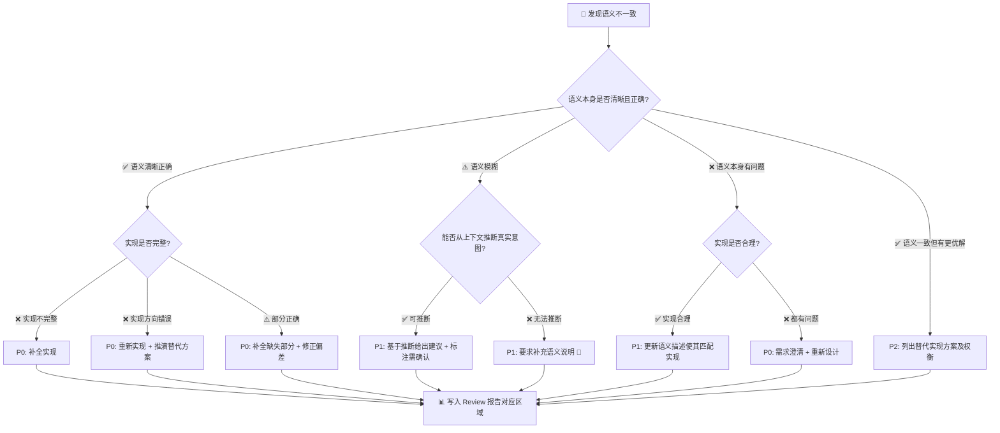

# Code Review 详细检查清单与模板参考

> 本文件是 [SKILL.md](SKILL.md) 的配套参考。主 agent 在波次2 执行维度 0/4 时、子 agent 在波次1 执行维度 1/2/3/5/6 时，按对应章节提取完整检查清单。

> **严重度术语映射**：本文件中的 `P0` / `P1` / `P2` 是**审查分级标记**，与报告模板的对应关系为 `P0 ≈ 🔴`、`P1 ≈ 🟡`、`P2 ≈ 提示`。**报告输出一律用 🔴/🟡 + 归属**（见第十二节），不写 P0/P1——分级标记只用于本文件内的判定与分类表。

## 一、维度 0：语义一致性详细检查项

### 0.1 提交意图 vs 实际实现

- commit message 说的"修复X"，代码实际是否修复了X？
- 是否只修了表面症状而未解决根因？
- 是否混入了与意图无关的变更？（scope creep，命中后转 0.10 搭车变更审计单独立案）
- 修复是否完整？是否遗漏了同类问题的其他位置？
- **局部改动虽然自洽，但是否改变了整体功能对外承诺？**

### 0.2 注释描述 vs 代码行为

- 注释说"做A"，代码实际是否做A？
- 注释是否过时？是否描述的是旧版本的行为？
- 注释是否有误导性？（不完全准确、遗漏关键条件）
- "TODO"/"FIXME"/"HACK" 注释是否被正确处理？

**新增注释专项检查**（本次提交新增/修改的注释，可信度默认低）：

1. **一致性**：注释说"验证X/处理Y"，代码是否真的做了？
2. **完整性**：代码是否做了注释没提到的事情？
3. **准确性**：是否过度承诺（注释说的比代码做的多）或不足承诺？

严重性：严重不一致 → P0；部分不一致 → P1；描述不完整 → P2。不一致时以代码行为为准，并在报告中显式提示用户核实。

### 0.3 docstring vs 函数实际行为

- docstring 描述的参数/返回值与实际是否一致？
- docstring 声明的异常与实际抛出的异常是否一致？
- docstring 描述的副作用与实际副作用是否一致？

### 0.4 命名语义 vs 实际职责

- 函数名说"get_xxx"，实际是否只做读取？还是也有修改？
- 函数名说"validate_xxx"，实际是只验证还是也做了转换？
- 变量名暗示的数据类型/结构是否与实际使用一致？
- 类名暗示的抽象层次是否与实际实现匹配？
- 方法 / 类 / 模块的命名所表达的**整体职责**，是否仍与改动后的实际行为一致？

### 0.5 调用关系的语义传递性（避免"借错工具"）

当函数通过调用下游对象（handler / model / service / API / 第三方库 / 工具函数）实现自身语义时，必须验证调用关系是否构成**语义可传递链**——不能默认"被调对象的语义就是调用方需要的语义"。

**核心追问（按层递进）：**

1. **被调对象的语义是什么？**——不看名字，看其实际承诺（文档 / 字段定义 / 源码行为）
2. **调用方的语义是什么？**——来自已建档的语义声明
3. **两者是否可传递？**——输入语义、输出语义及下表各类隐式语义维度，是否都能支撑上层诉求？
4. **不可传递时，问题在哪一层？**
    - 仅是参数没传对 → 在原调用上修参数（改动最小）
    - 被调对象在概念维度上就不匹配（如用"实体生命周期查询"实现"事件统计"）→ 必须**更换被调对象**或**新建合适抽象**，禁止在错误对象上叠参数
    - 项目里本就缺乏合适的抽象 → 建议先补抽象再实现

**隐式语义维度清单（最易被忽略）：**

| 维度          | 不匹配示例                                                       |
| ------------- | ---------------------------------------------------------------- |
| 时间语义      | `create_time` / `update_time` / `event_time` / 业务有效期 互相代用 |
| 集合语义      | "实体集合" vs "事件流" vs "状态快照" 互相代用                     |
| 一致性语义    | 强一致 / 最终一致 / 缓存读 互相代用                              |
| 边界语义      | 闭区间 / 半开区间 / 含/不含未结束记录                            |
| 单位/精度     | 秒/毫秒、分页/全量、聚合粒度                                     |
| 权限/可见性   | 已过滤 vs 未过滤、当前用户 vs 全局                               |
| 排序/截取     | 隐含排序方向、是否已 limit                                       |

**审查动作：**

- 在项目内检索是否已存在更贴近上层语义的对象/接口（grep 类名、文档名、相关字段）
- 若存在 → 优先建议"换数据源 / 换抽象"；若不存在 → 建议先补充合适抽象再迁移实现
- **禁止在概念错配的对象上"打补丁"**（加参数、加 if、加注释解释）来掩盖语义错配

### 0.6 局部改动 vs 整体功能语义（纵向）

即使某一小段变更本身逻辑正确，也必须验证它是否破坏了所在方法、类、模块或业务流程的整体语义。

**重点检查：**

- **方法整体语义**：局部修改是否改变了方法原本的输入约束、返回契约、异常语义、副作用或幂等性？
- **类 / 模块整体语义**：某个方法局部修复是否打破了类的职责边界、状态一致性、封装假设或模块对外契约？
- **业务流程整体语义**：局部逻辑正确，但是否导致上游/下游流程的业务含义发生偏移？
- **跨分支一致性**：某个分支被修正后，其他分支是否仍与整体语义保持一致？
- **局部优化副作用**：为了性能、容错、兼容性做的局部改动，是否牺牲了整体正确性或可观察性？

**审查动作：**

- 读取变更所在函数 / 方法的完整实现，而非只看变更行
- 必要时回溯其调用方、实现方、重写关系、接口定义或测试用例
- 用一句话显式概括该方法 / 类 / 模块的**整体语义**，再判断改动后是否仍成立
- 若局部正确但全局失真，按 **阻塞级语义破坏** 处理

**典型风险：**

- 只修正某个 `if` 分支，但破坏了整个方法"返回统一数据结构"的语义
- 只优化局部异常处理，却让调用方无法再区分真实失败与空结果
- 只增强某个参数分支，却让类从"只读查询"悄悄变成"查询 + 写入"

### 0.7 条件路径语义一致性检查（横向）

**核心问题**：函数参数不同，执行路径不同，路径语义也不同。修改后，各条路径的语义是否仍然一致？

**0.7.1 参数空间枚举**——对被修改函数，显式枚举参数驱动的主要路径分支：

| 参数组合 | 执行路径 | 路径语义 | 修改后是否受影响 |
|----------|----------|----------|------------------|
| `<param_值域A>` | `<路径描述>` | `<该路径的语义承诺>` | ✅ / ⚠️ / ❌ |
| `<边界/空值/异常值>` | `<路径描述>` | `<该路径的语义承诺>` | ✅ / ⚠️ / ❌ |

**0.7.2 隐式条件空间**——除显式参数外，检查影响执行路径的隐式条件：

| 隐式条件 | 影响路径 | 修改后是否受影响 |
|----------|----------|------------------|
| 对象/实例状态（如 `self.xxx` 是否已初始化） | `<走状态A vs 走状态B>` | ✅ / ⚠️ / ❌ |
| 全局/模块状态（如配置开关、feature flag） | `<新逻辑 vs 旧逻辑>` | ✅ / ⚠️ / ❌ |
| 外部依赖返回值（如查询结果有无、API 是否超时） | `<正常路径 vs 降级路径>` | ✅ / ⚠️ / ❌ |
| 并发状态（如缓存是否命中、锁是否持有） | `<独占执行 vs 排队等待>` | ✅ / ⚠️ / ❌ |

**0.7.3 路径间语义一致性**——不同路径之间语义是否互相矛盾：

- 参数A走路径1返回"成功"，参数B走路径2返回"成功"——两种"成功"的含义是否一样？
- 修改后某条路径的返回语义发生偏移，但调用方可能只测了另一条路径
- 某条路径的异常类型/错误码被修改，但调用方按原类型做了分支处理

**0.7.4 修改影响的路径定位**：

- 修改的代码行，在哪些参数/条件下会被执行到？
- 完全不受影响的路径 → ✅；受影响但语义一致 → ⚠️ 可接受；受影响且语义变化 → ❌ 必须修复

**审查动作：**

1. 识别被修改函数的所有主要分支（if/elif/else、switch/match、try/except、early return、guard clause 等）
2. 对每个分支，明确其**触发条件**和**路径语义**（该路径承诺了什么输入→输出→副作用）
3. 判断修改行落在哪些分支内，哪些分支不受影响
4. 对受影响的分支，验证修改后路径语义是否仍与整体语义一致
5. 特别关注**低频路径**（异常分支、降级分支、边界条件分支）——平时很少触发，最易被修改破坏却难以在测试中发现

**典型风险：**

- ❌ 只修了正常路径的 Bug，但忽略了异常路径下同类问题
- ❌ 参数 A 下的修改正确，但参数 B 下修改反而引入了新问题
- ❌ 修改改变了空值/None/默认值参数下的行为，但调用方依赖了原来的行为
- ❌ 修改影响了某条并发路径的语义（如锁的获取/释放时机），但串行测试无法覆盖
- ❌ 修改让某条路径的副作用从"无"变成"有"（或反过来），但调用方按原语义做假设

### 0.8 执行场景语义一致性检查（场景维度，补充 0.7）

适用于两类 0.7 覆盖不到的情况：**无参数函数**（如 `init()`、`cleanup()`）和**非参数驱动的分支**（全局状态、外部依赖、并发条件、调用时机）。核心思路：**基于函数的功能意义识别执行场景，而非依赖参数值域**。

**0.8.1 使用场景识别**（AI 自主判断）：

| 场景维度 | 识别依据 | 示例场景 |
|----------|----------|----------|
| 调用时机 | 函数在业务流程中的位置 | 初始化阶段、运行时、关闭清理、定时任务触发 |
| 调用频率 | 预期的调用模式 | 单次调用、批量调用、首次调用 vs 重复调用 |
| 外部状态 | 依赖的外部资源状态 | DB 可用/不可用、缓存命中/未命中、网络正常/超时 |
| 业务上下文 | 调用时的业务状态 | 新用户/老用户、正常流程/补偿流程 |
| 异常场景 | 可能的异常情况 | 超时、并发冲突、资源不足、部分失败 |
| 并发条件 | 多线程/协程环境 | 串行执行、并发调用、锁竞争、竞态条件 |

**0.8.2 修改代码的场景覆盖分析**：

1. 定位被修改的代码行（通过 diff 或 PR）
2. 对每个识别出的执行场景，判断修改代码是否会被执行
3. 如果会执行，验证该场景下修改后的语义是否正确
4. 如果不确定是否会执行，标注为 ⚠️ 需确认

**审查动作**：

1. 理解函数的功能意义（读 docstring、注释、调用方）
2. 识别 3-5 个主要执行场景（不需要穷举，覆盖关键场景即可）
3. 对每个场景，判断修改代码是否被执行；对受影响的场景验证语义一致性
4. 特别关注**异常场景**和**低频场景**

**典型风险**：

- ❌ 修改在正常流程下正确，但在异常恢复场景下行为错误
- ❌ 修改在单次调用下正确，但在批量调用下引入性能问题或副作用
- ❌ 修改在初始化阶段正确，但在运行时重复调用下产生状态污染
- ❌ 修改在外部依赖正常时正确，但在降级/超时场景下语义破坏
- ❌ 修改在串行执行下正确，但在并发调用下产生竞态条件

### 0.9 数据流守恒检查（数据维度）

适用于变更涉及**数据的生产、转换或消费**的场景（查询/过滤/聚合/序列化/写入/消息发送等）。核心思路：**不看代码对不对，看数据从生产到消费是否守恒**——代码局部正确但数据悄悄变少/变多/变形，是静态审查最容易漏掉的静默 Bug 类。

**0.9.1 守恒三问**：

| 守恒检查 | 核心问题 | 典型破坏方式 |
|----------|----------|--------------|
| **流向** | 数据的去向/消费方与修改前一致吗？ | 写入目标表改变、事件不再发给某订阅方、返回值不再包含某下游依赖的数据 |
| **数量** | 到达消费方时数量有无静默增减？（如原 10 条、消费时只剩 5 条） | 过滤条件收紧、异常吞掉整批、去重/分页/LIMIT 误加、JOIN 类型改错（inner↔left）导致丢行或笛卡尔积翻倍、重复消费 |
| **内容** | 数据到达消费方时还是原样吗？ | 字段被覆写/丢弃、精度丢失（float→int、时区截断）、编码/格式转换、序列化静默丢字段（如 ORM/DRF 序列化器未声明的字段被静默丢弃） |

**0.9.2 审查动作**：

1. 识别变更触碰的数据实体（集合/记录/字段），画出其修改前的「生产 → 转换 → 消费」**双轨链**：正常轨 + 异常轨（数据在异常分支下的走向）
2. 对比修改后的链路，逐跳回答守恒三问（流向/数量/内容），异常轨与正常轨同等过三问
3. **异常路径归宿核查（强制）**：标出数据链上所有异常处理点（`try/catch`、`except: continue/pass`、`if err != nil { continue }`、`.catch()` 后不再抛、错误回调忽略、消费失败仍 ack、重试耗尽无死信），逐点回答"异常发生时这条数据的最终归宿是什么？"（重试/死信/补偿/上抛/有记录的丢弃/静默丢弃）；**静默丢弃（无日志、无补偿、无上抛、消费方无感知）→ 按数量守恒破坏处理**，不因"catch 后跳过看似没毛病"放行；静默丢弃本身最低 ⚠️（不可观测即缺陷，要求补记录/补偿或论证该数据可丢弃），不得因效果判 🟰 而完全放行
4. 任一问命中变化 → **枚举该数据的所有消费方**（grep 调用点/订阅方/下游表读取方），逐个做**效果等价性判定**，强制两问：① 消费方拿这份数据做什么？（展示/计算/告警/资金/决策/存档/转发）② 用变化后的数据产生的效果，与原数据产生的效果一致吗？
5. **效果三档判定**（以消费端效果而非数据变化幅度定级）：🟰 **效果一致**（消费方不使用受影响部分，或逻辑上等价；须列出消费方清单并逐个论证，且与提交意图交叉验证——恰好无影响不等于有意为之）→ ✅；🟡 **影响可忽略**（效果有差异但业务上可容忍——此为审查者推断，须标注待确认交用户/业务判断，并与提交意图交叉验证）→ ⚠️；🔴 **影响重大**（报表失真、告警漏报/误报、资金/计费偏差、下游决策改变、不可逆数据丢失）→ ❌ Bug（P0/P1 按影响面定级），**不可逆的（数据丢了补不回）一律从重**；无变化 → ✅
6. 静态无法确认实际数据量变化或异常触发概率时（如过滤条件/异常率依赖运行时数据分布），标注 `[需运行验证]`，汇总到报告 A3「测试验证建议」供阶段 8 动态验证；快速模式下建议接力 debug / e2e-testing

**0.9.3 新增数据贯通检查（端到端，贯通两问）**：

守恒三问查**存量**（原有数据变了吗），本节查**增量**（新增数据通了吗）。**触发条件**：diff 新增了数据元素——API 请求/响应字段、Model 字段/表列、消息/事件字段、配置项等。新增元素没有"修改前链路"作对比基准，三问天然探不到它的断链，必须单独走贯通两问：

| 贯通检查 | 核心问题 | 审查动作 |
|----------|----------|----------|
| **正向贯通**（新增输入 → 最终落点） | 新增的字段/数据源沿链路每一跳都被接住了吗？最终真的落到预期终点（入库/发送/返回）了吗？ | 逐跳追链：接口/DTO → 参数校验 → service → Model/ORM 映射 → migration/表结构 → 序列化/发送，标出没接住的那一跳 |
| **反向消费**（新增产出 → 使用方） | 新增的字段/产出，谁生产它？谁消费它？ | 深度模式已加载专家资产 C4（数据流向与消费）时优先对照其消费方清单；否则 grep 写入方与读取方：无写入方 → 永远为空的空壳字段；无读取方 → 死字段 |

**判定规则**：

- **断链**（某跳没接住，如 API 收了字段但 Model 未映射、migration 缺列）→ 新增字段通常就是提交意图核心，断链即意图未达成，联动 0.1 判定，按影响面定 P0/P1
- **死字段/空壳字段** → 不武断判错：可能是分阶段提交的前置铺垫，标注 🟡 待确认，请用户确认后续提交是否会补上生产/消费方
- **消费方在仓库外**（前端/下游系统读取）→ 静态不可见，标注 `[消费方在仓库外，需人工确认]`，不计入死字段
- 贯通性依赖运行时行为（动态字段映射、反射、schema-less 存储）→ 标注 `[需运行验证]`，汇总到报告 A3「测试验证建议」供阶段 8 动态验证

**典型风险**：

- ❌ 修改过滤条件后某类记录被静默排除，下游报表数据无声变少，测试全绿
- ❌ 批处理中单条异常被 catch 后 continue，整批中失败项静默丢弃且无补偿/记录
- ❌ catch 后返回默认值/空集合，调用方无法区分"真没有数据"与"出错了"，数据缺失被默认值掩盖
- ❌ 消息消费抛异常仍被 ack/提交 offset，消息既未处理也不再投递，永久丢失
- ❌ 序列化层字段声明与模型不同步，新增字段在 API 响应中静默缺失
- ❌ JOIN 类型或关联条件修改导致结果集行数变化，聚合统计值静默失真
- ❌ 消息/事件改造后某订阅方不再收到通知，但该订阅方不在本次 diff 可见范围内
- ❌ API 接口新增字段并通过校验，但 ORM Model/migration 未同步，字段被静默丢弃从未入库，接口测试全绿（只断言了 response，没人断言落库）
- ❌ Model 新增字段无任何读取方（死字段），或无任何写入方（永远为 null 的空壳字段），长期无人发现

### 0.10 搭车变更审计（范围维度）

适用于 diff 中含有**与声称意图无关的改动**的场景（修 bug 时顺手优化、加功能时顺手重构、顺手删"冗余"代码）。核心思路：**搭车变更没有意图授权，却往往享受最低的审查强度**——它逗留在"主修复"的光环下溢出评审视野，而且隐含一个未经证明的假设："原写法是没必要的"。看似可优化的代码经常是前人踩坑后立的围栏（切斯特顿围栏）：看似重复的校验是防御性兼容、看似多余的拷贝是防共享可变状态、看似可合并的两次查询是事务隔离需要、看似无用的延迟是上游限流约定。

**0.10.1 拆分与识别**：

1. 以阶段 3 确认的声称意图为尺，逐段把 diff 分为「必要变更」（去掉它声称意图就不成立）与「搭车变更」（去掉它意图依然完整达成）
2. 搭车变更的典型信号：删除"冗余"校验/中间变量/拷贝、简化条件表达式、合并看似重复的代码、调整语句/调用顺序、替换数据结构或 API、重命名/格式化之外的"顺手重构"

**0.10.2 审查动作（逐条搭车变更立案，正确性先行）**：

1. **正确性审查（硬门禁）**：对搭车变更执行 0.6 全局回扣与 0.9 守恒三问，审查标准与主变更完全一致，先回答"这条改动本身对不对"
2. **围栏检查（正确性证据来源）**：原写法是不是故意的？依次查：原代码行附近注释（含 HACK/NOTE/不要优化类提示）→ `git log -L`/`git blame` 看原写法的提交信息（尤其是 bug 修复提交留下的写法）→ 是否有测试用例专门锁定原行为；围栏检查结果作为正确性判定的证据输入，而非独立判定档位
3. **两段式判定**：
   - **第一段（正确性门禁）**：不正确（破坏全局判据/数据守恒）→ ❌ P0，阻断提交，修复或回退（局部看是优化、全局看是 bug，"拆分独立提交"不能替代修复）；正确性无法证明（围栏 ❓ 且无其他证据支撑）→ ⚠️ 要求改动方补证或回退，不得仅以"拆分独立提交"作为放行手段（拆分不改变其正确性未知的事实，举证责任在改动方）
   - **第二段（提交组织建议，仅对已证正确的搭车变更）**：✅ 放行，建议拆分为独立提交单独评审，保持变更原子性

**典型风险**：

- ❌ 修 bug 时顺手删掉"重复"的参数校验，而该校验是另一条调用链的唯一防线
- ❌ 顺手把两次查询合并为一次，破坏了原有的读取时序（第二次查询依赖第一次后的中间状态）
- ❌ 顺手把深拷贝改成浅拷贝"提升性能"，下游修改返回对象时污染共享状态
- ❌ 顺手调整初始化顺序"更合理"，破坏了隐式依赖（前一步为后一步准备环境）
- ❌ 搭车变更与主修复耦合在同一提交，回滚主修复时被迫一并回滚或遗漏回滚

### 不一致分类与处理策略

| 不一致类型                 | 严重级别 | 处理策略                    |
| -------------------------- | -------- | --------------------------- |
| 🏚️ 语义正确，实现方向错误   | 🔴 P0     | 给出正确实现方案 + 推演思路 |
| 🎭 语义正确，实现不完整     | 🔴 P0     | 标注遗漏部分 + 补全方案     |
| 📝 实现正确，语义描述有误   | 🟡 P1     | 指出描述应如何修正          |
| 🤷 语义模糊，难以判定一致性 | 🟡 P1     | 要求补充语义说明            |
| 🚀 语义一致，但有更优实现   | 🟢 P2     | 给出优化建议及理由          |
| ⚖️ 语义与实现部分重叠       | 🟡 P1     | 澄清意图后判断              |
| 🔄 注释/文档过时            | 🟡 P1     | 标注需更新的文档            |
| 🧭 调用关系语义不可传递 | 🔴 P0 | 指出错配维度（时间/集合/一致性/...）→ 检索更合适的抽象 → 给出迁移方向；禁止在原对象上打补丁 |
| 🛤️ 条件路径语义不一致 | 🔴 P0 | 枚举受影响路径 → 逐条验证路径语义与整体语义的一致性 → 标注哪些路径语义被破坏 |
| 📉 数据流守恒破坏 | 🔴 P0 | 定位变化点（流向/数量/内容）→ 枚举所有消费方逐个判定影响 → 受影响则修复，全部兼容则标注待确认 |
| 🚙 搭车变更正确性存疑 | 🟡 P1（破坏全局则 🔴 P0） | 正确性先行：0.6/0.9 审查不正确 → 阻断提交，修复或回退；围栏检查（注释/blame/测试）无法证明正确 → 要求补证或回退，拆分不能替代修复；已证正确 → 才建议拆分独立提交单独评审 |

### 语义不一致分析模板（含精确/鲁棒双方案）

发现语义不一致时，执行深度推演并输出：

```
语义不一致分析 #M1
  语义来源: S1 (commit message: "修复用户登录时的空指针异常")
  🤖 AI 对该语义的理解: "作者希望解决 login() 在 user 不存在时抛 NoneType 异常的问题"
  实际实现: 新增了 try/except 捕获 None 并返回空对象
  不一致类型: 修复策略偏差

  🔍 推演分析:
  - 语义要求的意图: 修复空指针的根因（为什么 user 会是 None？）
  - 实际实现做了什么: 绕过了空指针，但未解决根因
  - 根因判断:
    □ 实现正确但语义描述不精确？→ 建议更新提交说明
    ☑ 语义正确但实现有偏差？→ 建议重新实现
    □ 两者都不够清晰？→ 需进一步讨论

  💡 建议方向:
  1. 追溯 user 为 None 的来源，在上游修复
  2. 如果 None 是合法状态，应在类型系统中显式表达（Optional[User]）
  3. 当前"静默吞掉 None"的方案可能掩盖更深层问题

  🔄 解决方案对比（精确 vs 鲁棒）:

  ─── 方案 A：精确方案 ───
  目标: 在当前上下文中完全精确地区分"用户不存在"与"系统异常"
  适用: 内部私有方法、调用方可控、上下文稳定的场景

  def login(user_id: str) -> LoginResult:
      """登录验证，区分用户不存在与系统异常两种失败原因。"""
      try:
          user = user_repo.get(user_id)
      except RepoError as e:
          return LoginResult.system_error(reason=str(e))
      if user is None:
          return LoginResult.user_not_found(user_id)
      return LoginResult.ok(user)

  优点: 调用方能精确区分失败类型，无信息丢失
  代价: 引入 LoginResult 抽象，调用方需配合改造；若 user_repo 行为变动则可能失配

  ─── 方案 B：鲁棒方案 ───
  目标: 不追求极致精确，但在关联代码变动时仍可控
  适用: 公共接口、跨模块调用点、关联代码可能变动的场景

  def login(user_id: str) -> Optional[User]:
      """登录验证，未找到用户或异常时统一返回 None 并记录日志。"""
      try:
          user = user_repo.get(user_id)
      except RepoError:
          logger.exception("login repo error: user_id=%s", user_id)
          return None
      if user is None:
          logger.warning("login user not found: user_id=%s", user_id)
          return None
      return user

  优点: 接口签名简单稳定，调用方仅需判 None；user_repo 行为微调不会牵动调用方
  代价: 调用方无法区分"用户不存在"与"系统异常"；需依赖日志做问题定位

  📊 权衡建议:
  - 被修改函数的可见性: <内部方法 / 模块内 / 公共接口>
  - 关联代码变动风险: <低 / 中 / 高>
  - 调用方对精确性的需求: <低 / 中 / 高>
  - 推荐方案: <A / B / 视调用场景而定>
  - 推荐理由: <基于可见性与变动风险给出选择依据>
```

> ⚠️ 当且仅当存在"更简单但鲁棒性更好"的替代方案时，才需要呈现双方案对比；若问题本身只有唯一合理修复路径，可只输出方案 A。

### 语义一致性检查决策树



## 二、维度 1：安全性检查清单（波次1 · 子 agent-A）

**🔴 高危项（可能直接导致安全事故）：**

- **SQL 注入**：是否使用参数化查询？是否有 f-string / `.format()` / `%` 拼接 SQL？
- **命令注入**：是否有 `os.system()` / `subprocess` 使用未转义的外部输入？`shell=True` 是否必要？
- **eval / exec / compile**：是否对不可信数据执行动态代码？`eval()` 永远不应该接受用户输入
- **SSTI 模板注入**：是否对用户输入调用 `jinja2.Template().render()` 或 `Template()` 直接渲染用户内容？
- **反序列化**：是否使用 `pickle.loads()` / `yaml.load()` 处理不可信数据？
- **错误路径安全不变量**：异常/降级/提前返回（early return）路径是否绕过了权限校验、审计日志、限额扣减等必须恒定执行的检查？错误处理分支不得成为安全旁路

**🟡 中危项（可能导致数据泄露或服务异常）：**

- **SSRF**：`requests.get()` / `urllib.request.urlopen()` 的 URL 是否来自用户输入且无域名/IP 白名单？
- **XXE 外部实体注入**：XML 解析是否禁用了外部实体？（应使用 `defusedxml` 或设置 `resolve_entities=False`）
- **路径遍历**：文件路径拼接是否校验了 `..` 等目录穿越字符？
- **文件上传安全**：文件名是否校验？MIME 类型是否服务端检测？存储路径是否可被外部直接访问？

**🟢 低危项（长期隐患）：**

- **敏感信息泄露**：是否硬编码密钥/密码/Token/AKID？若必须写在代码中是否标记了 `# nosec`？
- **日志注入**：用户输入写入 `logger.info()` 等日志前是否做了换行符清理？
- **ReDoS 正则拒绝服务**：正则表达式是否存在灾难性回溯？（嵌套量词：`(a+)+b`、`(a|aa)*`）
- **YAML 安全**：是否使用 `yaml.safe_load()` 而非 `yaml.load()`？
- **HMAC / 密码学**：是否自行实现了加密算法而非使用 `hmac.compare_digest()` 等标准库？

## 三、维度 2：Bug 与逻辑风险清单（波次1 · 子 agent-B）

**🔴 高频语言陷阱（按当前语言切换）：**

- **Python**：可变默认参数、`is` vs `==`、闭包延迟绑定、空异常捕获、`None` 类型混淆
- **JavaScript / TypeScript**：隐式类型转换、`this` 绑定丢失、异步竞态、`any` 扩散、未处理 Promise rejection
- **Java**：空指针、可变对象逃逸、`equals`/`hashCode` 不一致、并发容器误用、资源关闭遗漏
- **Go**：`nil` 接口陷阱、`defer` 时机误判、error 丢失、goroutine 泄漏、循环变量引用问题
- **Rust**：所有权 / 生命周期误判、错误传播缺失、`unsafe` 使用边界、阻塞与异步混用不当

**🟡 常见逻辑风险：**

- **浮点数比较**：`0.1 + 0.2 == 0.3` 为 False → 应用 `math.isclose()` 或 `Decimal`
- **上下文管理器泄露**：文件/连接/socket 未使用 `with` 语句 → 资源未释放
- **bytes/str 混淆**：文件读写、网络传输、加密操作中编码未明确指定
- **可变对象的共享引用**：类属性与实例属性混用可变默认值、全局可变状态的副作用
- **`__del__` 不可靠性**：循环引用导致 `__del__` 不被调用 → 关键清理应用 `with` / `atexit.register()`
- **深拷贝滥用**：`copy.deepcopy()` 对大型复杂对象 → 性能灾难 + 循环引用风险

**🔗 语义相关逻辑风险：**

- 实现与语义不一致导致的隐含 Bug（基于共享语义声明表初步判断，标注为跨维度线索，交由维度 0 在波次2确认）
- 函数"悄悄吞掉"异常但调用方不知情 → 下游错误积累
- **专家已知坑交叉对比**（当命中专家时）：逐一核对 C0 中的已知坑清单，检查本次修改是否重蹈历史问题模式。若命中已知坑，标注为阻塞项并引用 C0 中对应已知坑条目

## 四、维度 3：代码规范 & 语言惯用法清单（波次1 · 子 agent-A）

- 命名规范：遵循当前语言及项目约定（如 PEP 8、Effective Java、Go Code Review Comments、Rust API Guidelines、TypeScript ESLint 约定等）
- 类型系统：是否合理使用 type hints / generics / interfaces / traits / annotations 等能力？
- 文档契约：公开函数、类、接口是否有必要的 docstring / 注释 / API 说明？
- 简洁性：是否符合当前语言的惯用写法，而不是机械照搬其他语言风格？
- **命名与语义**：命名是否准确反映实际职责？（基于共享语义声明表初步判断，标注为跨维度线索，交由维度 0 在波次2确认）

## 五、维度 4：架构与设计清单（波次2 · 主 agent）

- 单一职责：函数/类是否职责清晰？
- 依赖方向：是否产生循环依赖？
- 抽象层次：是否正确使用 ABC / Protocol / Mixin？
- 接口设计：参数数量是否合理？
- **职责漂移**：实际实现是否偏离了该模块应有的职责边界？
- **专家架构对齐**（当命中专家且深度模式时）：以 implementation/01-架构 描述的模块分层、依赖图、子模块边界为基准，检查修改是否违反架构约束（如将底层实现细节泄露到上层、绕过既定的分层调用路径等）

## 六、维度 5：性能隐患清单（波次1 · 子 agent-B）

- 循环内的 I/O 或重复计算
- 字符串拼接使用 `+` 而非 `.join()` / f-string
- 大列表使用 `list.index()` 而非 set/dict 查找
- 不必要的列表创建（可用生成器替代）
- **语义不必要**：实现中是否做了语义并未要求的重量级操作？

## 七、维度 6：测试覆盖清单（波次1 · 子 agent-C）

**📋 测试存在性检查：**

- 新增/修改的公开函数、类是否在对应测试文件中新增或更新了测试？
- 修改已有功能时是否补充了回归测试？
- 修复 Bug 的提交是否包含了复现该 Bug 的回归用例？

**🎯 测试质量检查：**

- **测试是否验证了语义**：测试用例是否覆盖了语义声明的意图，而不仅仅是代码路径？
    - 例：语义说"修复空查询引起的 500"，测试应验证空查询场景，而不只是正常路径
- **测试层级选择**：纯逻辑变更 → 单元测试优先；跨模块交互变更 → 集成测试；用户可见行为变更 → 端到端测试
- **参数化覆盖**：边界值、等价类是否用了参数化测试（如 `@pytest.mark.parametrize`）？应覆盖：正常值 / 空值 / 边界值 / 异常值 / 极大值
- **Mock 使用合理性**：不应 Mock 被测对象本身；外部 I/O（网络、数据库、文件）→ 应 Mock；纯函数 → 不应 Mock

**🧪 测试基础设施检查：**

- **测试隔离性**：测试是否依赖全局状态或执行顺序？是否每个测试独立可运行？
- **fixture / factory 使用**：是否有重复的测试数据构造逻辑应提取为 fixture？
- **测试命名**：测试函数名是否描述了"做什么 → 期望什么"？（如 `test_login_with_expired_token_returns_401`）

## 八、语义声明表完整格式与示例

> **本节是审查过程的内部产物格式，不是报告的一节**：语义声明用于推理与在附录 A1 的「依据」字段中引用（`A*` / `S*`），**报告不再单独输出语义声明表**（见第十一节报告分层）。权威语义在报告里的呈现位置是 §0.5「我的理解」。

语义声明分两类：**权威语义**（来自功能意图推理阶段，标记 `[权威]`）与**辅助语义**（来自语义提取阶段，标记 `[辅助]`）。

```
语义声明 S1 [权威: 阶段 3 功能意图]
  🤖 AI 推测: "login() 的功能意图是验证用户身份并返回用户对象，验证失败时返回 None"
  用户确认: ✅ 已确认 / ⚠️ 已修正为："<用户修正的内容>" / ⏩ 快速模式未确认（置信度 🟢）
  涉及: auth.py:login()

语义声明 #S2 [辅助: commit message]
  原文: "fix: 修复用户登录空指针"
  🤖 AI 理解: "作者希望解决 login() 在 user 不存在时抛出 NoneType 异常的问题"
  置信度: 高 / 中 / 低
  与权威语义关系: ✅ 一致 / ⚠️ 补充 / ❌ 冲突
  涉及: auth.py:login()

语义声明 #S3 [辅助: docstring]
  原文: "Calculate order total with discount and tax."
  🤖 AI 理解: "该函数承诺：输入订单 → 输出包含折扣与税费在内的最终可结算金额"
  置信度: 高
  与权威语义关系: ✅ 一致 / ⚠️ 补充 / ❌ 冲突
  涉及: order.py:calculate_total()

语义声明 #S4 [辅助: 注释]
  原文: "# 此处需要处理并发情况"
  🤖 AI 理解: "此处存在多协程/多线程同时进入的可能，原作者认为需要加锁"
  置信度: 中（注释过于笼统）
  与权威语义关系: ✅ 一致 / ⚠️ 补充 / ❌ 冲突
  涉及: cache.py:42
```

## 九、专家资产在各阶段的用途映射

| 专家资产 | 辅助的审查阶段 | 具体用途 |
|----------|--------------|----------|
| C0 能力清单 + 边界 | 功能意图推理 | 了解模块原本的能力范围和边界，辅助判断被改代码的功能意图是否合理 |
| C0 已知坑 | 维度 2（Bug 风险） | 检查本次修改是否重蹈模块历史上已知的问题模式 |
| C1 能力契约 | 维度 0（语义一致性） | 以公开方法的参数/返回/异常/约束契约为基准，逐项检查修改是否破坏既有契约 |
| C4 数据流向与消费（如有） | 维度 0.9（数据流守恒） | 提供现成的数据实体→消费方→业务用途清单，免去从零追查消费链；消费端效果定级（🟰/🟡/🔴）时按其业务用途判断影响重大性；带 `[基于引用扫描，未深入验证]` 标注的消费方需实际追查确认 |
| implementation/01-架构 | 维度 4（架构设计） | 以模块架构为参考基线，检查本次修改是否符合架构约束和设计意图 |
| implementation/02-实现 | 维度 2（Bug 风险） | 理解核心实现模式和关键路径，判断修改是否与既有实现风格一致 |
| implementation/03-数据流转 | 维度 0.6（整体语义） | 理解数据在模块内外的流动路径，检查修改是否影响数据一致性或跨模块行为 |

## 十、阶段 8：测试验证详细检查清单

> 除阶段 8 外的各阶段为静态审查，阶段 8 为其动态补充。当报告 A3「测试验证建议」有内容时，由阶段 8 创建并执行临时测试，动态验证数据流连通性与复杂逻辑正确性。

### 触发条件

| # | 条件 | 动作 |
|---|------|------|
| 1 | 报告 A3「测试验证建议」有内容 | AI 自动触发 |
| 2 | 无显式建议项，但 AI 评估认为动态验证有价值 | 提示用户：「建议进行测试验证，原因：{...}」，用户确认后触发 |
| 3 | 无建议项且 AI 评估无需验证 | 跳过 |

> 审查中按"不确认就跑"原则（约束 #21）标记的 `🧪 建议测试验证` 项，是条件 1 的主要输入——审查阶段未静态收敛的逻辑，本阶段统一通过临时测试获得确定性证据。
>
> 快速模式（≤5 行）跳过本阶段；快速模式报告不套用完整模板（无 A3 测试验证建议），审查中标有 `🧪 建议测试验证` 的项改为在问题清单末尾提示「建议手动接力 debug / e2e-testing 验证」。

### 环境前置检查

执行前必做——检测运行时依赖可用性：

| 检查项 | 检测方式 | 不可用时处理 |
|--------|----------|-------------|
| 数据库连接 | 尝试连接配置的 DB | 标注 `[DB 不可用]`，涉及 DB 落库的验证项降级 |
| 消息队列可达性 | 尝试连接消息队列 | 标注 `[MQ 不可用]`，涉及消息发送的验证项降级 |
| API 可达性 | 尝试请求相关 API | 标注 `[API 不可用]`，涉及 API 调用的验证项降级 |

> 全部不可用 → 整体降级为标注 `[环境不可用，建议接力 debug/e2e-testing]`，不创建任何测试脚本。部分不可用 → 仅对可用环境创建测试，不可用部分降级标注。

### 测试创建要点

| 测试维度 | 验证内容 | 断言位置 |
|----------|----------|----------|
| 连通性 | 数据从入口注入后，是否抵达预期消费层 | 消费层（DB 表/API 响应/消息队列/日志） |
| 正确性 | 抵达消费层的数据内容/格式/数量与预期一致 | 消费层逐字段断言 |

**测试结构模板**：

```
# data-flow-test-{验证项标识}-{时间戳}.{ext}
# NOT FOR CI - code-review temporary test

## 1. 测试目标
- 数据流/逻辑：{入口} → {中间转换} → {消费层/输出层}
- 来源：报告 A3「测试验证建议」第 {N} 项
- 静态结论：{⚠️/需运行验证的原因}

## 2. 连通性验证
- 在 {入口} 注入测试数据：{测试数据描述}
- 在 {消费层} 断言数据是否抵达：{断言方式}
- 预期：{预期结果}

## 3. 正确性验证
- 断言抵达数据的字段/格式/数量：{断言清单}
- 预期：{预期值}

## 4. 异常路径验证（如适用）
- 模拟异常：{异常场景}
- 断言数据归宿：{预期归宿——重试/死信/补偿/上抛/有记录丢弃/静默丢弃}
```

### 存储位置优先级

| 优先级 | 条件 | 存储路径 | 说明 |
|--------|------|----------|------|
| 1 | 有对应专家团（阶段 2 命中） | `{专家目录}/test/` | 优先存入专家资产，丰富模块测试知识 |
| 2 | 无专家，有需求（阶段 2.4 命中 req） | `{需求目录}/test/` | 关联需求，便于追溯 |
| 3 | 两者都没有 | `.codebuddy/review/data-flow-test/` | 避免使用 `.test/` 或 `test/`，防止被 pytest 等框架自动发现 |

### 单元测试交互详细流程

1. **检测单元测试存在性**：grep 与数据流/逻辑相关的测试文件（按模块名/函数名/类名匹配）
2. **有单元测试**：
   - 执行现有单元测试 → 通过 → 在对应测试文件中补充覆盖新增数据流/逻辑的测试用例
   - 执行现有单元测试 → 不通过 → 评估修复成本：
     - **可低成本修复**（修改量 ≤ 10 行、不涉及框架迁移、**不修改现有断言语义**）→ 修复 → 重新执行 → 通过 → 补充新用例
     - **不可低成本修复**（含断言语义错误）→ 记录失败信息，不补充新用例
3. **无单元测试**：不补充单元测试，仅执行临时连通性测试

**断言保护规则**：低成本修复仅允许修改 setup/teardown、fixture 数据、import 路径等非断言部分。修改断言语义可能导致测试"绿了但无效"——测试通过却没测到对的东西，因此断言语义错误一律视为不可低成本修复。

### 单元测试失败记录格式

```markdown
## 已知单元测试失败

### {测试文件路径}:{测试函数名}

- **失败时间**：{时间}
- **失败原因**：{断言错误摘要}
- **修复尝试**：{尝试了什么，为什么不可低成本修复}
- **影响**：{对数据流验证的影响}
- **来源**：code-review 阶段 8 测试验证
```

### 测试结果解读

| 临时测试结果 | 报告结论回写 | 后续动作 |
|-------------|-------------|----------|
| ✅ 通过（连通 + 正确） | 验证项标注 ✅ | 确认数据链路/逻辑正常，无需额外动作 |
| ❌ 失败（连通性失败） | 验证项标注 ❌，写入第 1 节问题清单并补归属与业务后果 | 数据未抵达消费层 → 断链 Bug，按影响面定严重度 |
| ❌ 失败（正确性失败） | 同上 | 数据抵达但内容错误 → 数据变形 Bug，按影响面定严重度 |
| ⏸️ 无法执行 | 维持原标注，追加 `[动态验证执行失败：{原因}]` | 报告中建议手动验证 |

### 典型场景

- API 新增字段 → 临时测试在 API 入口注入字段值 → 断言 DB 落库 + API 响应包含该字段（连通性 + 正确性）
- 消息队列改造 → 临时测试发送测试消息 → 断言消费方收到且内容一致（连通性 + 正确性）
- 过滤条件修改 → 临时测试注入边界数据 → 断言消费方收到的数据量与预期一致（连通性 + 正确性 + 异常路径）
- 并发逻辑修改 → 临时测试模拟并发调用 → 断言状态一致性（场景验证）
- 跨模块副作用链 → 临时测试触发入口操作 → 断言下游模块状态正确变更（连通性 + 正确性）

## 十一、检查覆盖表与修复台账交接

> 对应 SKILL.md 阶段 4.5（派生）、阶段 6（输出）、阶段 9（交接）。本节给裁剪细则、格式与转写规则。

### 11.1 这张表解决什么

通用清单回答"**应该**查什么"，覆盖表回答"**这次**查了什么、没查什么、凭什么"。前者是基线，后者是可审计性——没有它，7 个维度的评分无法追溯，漏查也不可见（AI 说"都看了"，无人能验证）。

### 11.2 裁剪规则

**三档判据**（与 SKILL.md 阶段 4.5 一致，此处展开）：

| 档 | 典型内容 | 处理 |
|----|----------|------|
| 🔴 **必查** | 维度 1 全部安全项（注入 / SSRF / 凭据 / 反序列化 / 密码学）、0.9 数据守恒（diff 触及数据生产或消费）、对外契约（签名 / 返回值 / 异常 / API / 事件格式） | 无论有无可见风险都进表并留位置证据；无发现写"已查，无问题 + 查的位置" |
| 🟡 **相关** | 与改动面有交集的维度项 | 可标"低相关"，仍须给结论 |
| ➖ **不适用** | diff 完全不涉及 | 保留行 + 一句理由 |

**按 diff 特征映射**（裁剪时的速查表）：

| diff 特征 | 必须进表的项 |
|-----------|-------------|
| 新增 / 修改 SQL、查询条件 | 1 注入、0.9 数量守恒（过滤收紧或放宽）、5 性能（索引命中） |
| 新增 API 字段 / Model 字段 | 0.9 贯通两问（正向落库、反向消费）、3 规范（序列化声明同步）、6 测试（断言覆盖新字段） |
| 改状态机 / 枚举 | 0.7 路径语义、0.9 流向（下游消费方）、4 架构（职责归属） |
| 改权限 / 鉴权 | 1 权限校验穷举（**前端有、接口有没有**）、0.6 整体语义 |
| 改并发 / 异步 | 5 性能、0.8 场景、2 Bug（竞态）、6 测试（并发用例） |
| 改事务边界 | 0.9 数据守恒（部分失败）、2 Bug（回滚）、4 架构 |
| 删除能力 / 下线接口 | 0.10 范围、0.9 消费方（谁还在用）、4 架构 |
| 纯文案 / 样式 | 3 规范即可，其余标 ➖ |

**数量**：标准模式约 10~15 条、深度模式约 15~25 条——**参考区间不是配额**，总条数以 🔴 必查项全部覆盖为准；**禁止把多条必查项合并成一条凑数**，宁可超出区间。条数远超区间且必查项仍未覆盖完 → 该拆 review（与巨型变更"先建议拆分"同源）。

**审查范围不变**（对齐 SKILL.md 约束 4「变更聚焦」）：覆盖表只把检查视角前置，**不扩大评审范围**——对消费方 / 调用方的追查**只到"判定本次改动影响"为止**，不评审其代码质量、不因其既有问题记分。判据：这条核查不通过，是否会改变本次改动的结论？答案为否 → 不进表。

**四条禁止**：

- 不得以"本次改动小"为由删掉 🔴 必查项
- 不得把 `➖` 简写成"无"——必须说明**为什么与本次无关**
- 不得先查后补表——那样表退化为事后描述，失去防漏查作用；**骨架必须在阶段 4.5 生成**
- 不得借覆盖表**新增**检查规则——新检查项先补通用清单（本文件第二~七节），再进表

### 11.3 覆盖表格式

```markdown
| # | 维度 | 检查项（本次裁剪后） | 依据锚点 | 结论 | 证据 / 理由 |
|---|------|---------------------|----------|------|-------------|
| 1 | 1 安全 | 新增 filter 参数是否拼接进 SQL | 受影响代码 #2 | ✅ | `order_repo.go:88` 走参数化 |
| 2 | 0.9 数据流 | 状态过滤放宽后下游报表数据量是否增多 | 需求 AC-2 | ❌ | → `#1`（报表口径未同步） |
| 3 | 0.9 数据流 | 新增 `paid_at` 是否落库 | diff 新增字段 | ⚠️ | 缺 migration 证据 → 测试建议 #1 |
| 4 | 4 架构 | 过滤逻辑放 repo 层是否越层 | — | ➖ | 本次未改分层边界 |
```

**检查项写法**：必须能回答"通过 / 不通过"（对齐 plan-track 的"清单可判定"原则）。反例："注意安全性""代码是否规范"；正例："新增参数是否参数化查询""异常分支是否有记录或补偿"。

### 11.4 与评分联动

- 某维度在覆盖表中**全为 `➖` 或 `⚠️`** → 该维度评分不得 ≥ 9 分
- 某维度**全为 `➖`** → 标 `N/A 未评`，**不计入整体评分均值**，并在报告注明原因
- 作用：堵住"7 个维度都 10 分，实际只查了 3 个"

### 11.5 转 plan 的字段映射（阶段 9）

| plan 字段 | 从报告取什么 | 禁止 |
|-----------|-------------|------|
| 目标 / 完成判据 | 合入结论；判据 = §1 阻塞项清零 **且** 覆盖表 ❌/⚠️ 转 ✅ | 不得另立判据 |
| 工作项 | 报告第 1 节阻塞项（🟥/🟧 且 🔴）按条建行，描述只写 `#N` + 短标题，正文引报告 `#N`；既有缺陷不建工作项 | 不得复制分析过程；不得把附录 C 的历史债混进本次台账 |
| 注意事项（护栏） | 从「搭车变更审计」「0.9 数据守恒」结论提炼 | 不得复制整段分析 |
| checklist 增补组 | 覆盖表 ❌/⚠️ 项逐条转写 | 不得复制证据原文 |

**checklist 增补组（F 组）转写规则**：

1. 每条转成**可判定问法**，保留原锚点（需求 AC-N / 专家 C1 / diff 字段）
2. 严重度：原 ❌ 项 → P0；原 ⚠️ 存疑 → P1（涉及安全 / 数据 / 不可逆的仍按 P0）。**允许上调、禁止下调**——plan 建档时可因"不通过会产出错误结果"把上游 P1 上调为 P0（取两套口径中更严者），但不得把上游 P0 降为 P1 来放行（否则同一问题出现两套严重度，取低的那个等于放水）
3. 转写保留"守什么"，去掉"当时怎么查的"

示例：覆盖表 #2 `❌ 状态过滤放宽后下游报表数据量是否增多` → `F1｜报表消费端已同步同一口径，且改动前后同口径数据量对得上｜P0`。

### 11.6 与相邻机制的分工（三者不重叠）

| 机制 | 回答什么 | 何时 |
|------|----------|------|
| 检查覆盖表 | 该查的**查了吗** | 阶段 4.5 派生 / 阶段 5 回填 |
| `challenger` 二次质疑 | 结论**站得住吗** | 阶段 7（无阻塞项时自动） |
| 复检记录 | 问题**修好了吗** | 阶段 9 修复后 |

只做 challenger 会漏覆盖面（结论对，但该查的没查）；只做覆盖表会漏"结论本身错"。缺一都有盲区。

### 11.7 边界（本表不做什么）

- **不替代** `acceptance-verify` 的交付验收
- **不替代** `plan-track` 的 Step 3 任务级自评审——本表只覆盖"本次改动"，不覆盖"整个任务是否完成"
- **不改变**通用清单的权威性：覆盖表是裁剪视图，不是新规则
- 快速模式（≤5 行）不启用：此时报告只列问题，不产出覆盖表与台账

## 十二、问题归属判定与报告分层

> 对应 SKILL.md 阶段 5「问题归属判定」、阶段 6「报告分层」。本节给判定细则、常见误判与示例。

### 12.1 为什么必须是两个轴

**严重度**回答"这个缺陷有多糟"，**归属**回答"该不该阻塞本次合入"。二者正交，压成一个轴的后果是：

```text
只有严重度 → 🔴 自动等于「合入前必须完成」→ 三年前的历史缺陷阻塞本次 PR
```

典型翻车：review 一个 3 行的过滤条件改动，读到同文件里一段没有空值保护的旧代码，评 🔴，写进「合入前必须完成」，用户以为是自己改坏的，改完 `git blame` 才发现是 2023 年的代码——**提交被撑大、blame 被污染、回滚粒度被破坏**。

### 12.2 四分类判定细则

| 归属 | 定义 | 典型例子 | 反例（容易误判） |
|------|------|----------|------------------|
| 🟥 **本次引入** | diff 新增 / 修改的行或逻辑带来的问题 | 新加的分支漏了异常处理；改动的条件少了一个边界 | 把"本次改了调用处、被调函数原本就有问题"也标 🟥——那通常是 🟧 |
| 🟧 **本次激活** | 代码本身是旧的，但本次改动改变了它的**执行条件**（调用方 / 参数 / 时序 / 开关 / 数据量），使原本走不到的缺陷开始执行 | 旧函数一直以 `limit=10` 调用，本次改成不传 limit，暴露出没有上限保护；旧接口原只被内部调用，本次对外开放，缺少鉴权 | **把 🟧 标成 ⬜**（"代码是旧的"）——这是最危险的一类：责任在本次，却挂到历史账上 |
| ⬜ **既有** | 与本次 diff 无因果关系，且执行条件未被本次改变 | 顺手读到同文件里一段早已废弃的分支缺少日志 | 把"当前调用方恰好不触发"当成"永远不会触发"——若本次新增了调用方，它就是 🟧 |
| ❓ **待确认** | 静态判不了：历史被压平、跨仓库、blame 不可用 | 仓库是 squash 合入、只有一条初始提交 | **把 ❓ 直接写成 ⬜**（拿不准就归历史 = 系统性甩锅） |

**判定顺序**：diff 触及 → 🟥；执行条件被改 → 🟧；blame 早于本次且无调用关系 → ⬜；判不了 → ❓ + 验证方法。

### 12.3 blame 的用法与局限

```bash
git --no-pager blame -L <起>,<止> <file>
```

- **能证明什么**：该行的最后一次改动早于本次提交 → 至少排除 🟥。
- **不能证明什么**：不能排除 🟧——旧代码完全可能被本次改动激活。
- **局限**：squash / rebase 后历史被压平，blame 会指向一个巨大的提交，此时判不了就标 ❓，不要硬猜。
- **成本闸门**：只对"可能进 🔴"的发现问题跑 blame；🟡 及以下按代码阅读判断，拿不准标 ❓。

### 12.4 四类典型误判（评审自身要防的）

| 误判 | 表现 | 后果 | 防线 |
|------|------|------|------|
| **甩锅** | 明明是本次改出来的问题，标 ⬜ 既有 | 真问题不修，还写进"另开任务" | 🟧 一律按本次处理；⬜ 必须能说清"与本次无因果" |
| **过度归因** | 把历史代码的问题标 🟥，默认本次引入 | 修复范围膨胀、提交被撑大 | 🟥 要求该行落在 diff 增删行或紧邻上下文 |
| **拿不准归历史** | ❓ 一律按 ⬜ 处理 | 系统性地把难判的问题甩出去 | ❓ 必须给验证方法，且不因标 ❓ 而省略严重度 |
| **只做 diff 内审计** | 只按 0.10 查搭车变更，不看 diff 外的既有缺陷 | 读到历史缺陷后无归属依据，只能凭感觉 | 0.10（diff 内）+ 本兜底（diff 外）两条都走 |

### 12.5 报告分层判据

| 内容 | 放哪 | 判据 |
|------|------|------|
| 合入结论 / 阻塞项 / 整体评分 / 审查上下文 | 正文 §0 | 决定能不能合 |
| **七维度评分明细** | 正文 §0.1 | **是结论本身**——它直接回答"这次改得怎么样"，不是证据 |
| AI 对意图与全局图景的理解 | 正文 §0.5 | **是结论的前提**，错了整份报告作废 |
| 问题清单（含归属、业务后果、修复方向） | 正文 §1 | 是结论本身 |
| 需用户拍板项 | 正文 §2 | 需要人决策 |
| 问题推演 / 路径场景数据 / 测试建议 | 附录 A（**§1 全绿可整节省略**） | 是结论的**证据**，用于复核与争议举证 |
| 检查覆盖表 | 附录 B | 可审计性 |
| 既有缺陷 | 附录 C | 非本次范围 |
| 变更文件列表 | 附录 D | 备查 |

**最容易放错的四样**：① 意图理解（当前提，误放附录 → 读者先读到结论才发现前提错了）；② **维度评分**（当证据，误放附录 → 最直观的质量信号被藏起来）；③ 覆盖表（当正文 → 决策者被迫读审计材料）；④ 既有缺陷（当阻塞项 → 历史债绑架本次）。

**附录 A 的边界**：它是**争议时才有用**的材料，不是每次都要写——全绿时整节省略；有问题时只写 §1 的条目，每条 4 项。把它当"必填过程记录"会让报告重新变长。

### 12.6 与相邻机制的分工

| 机制 | 管什么 | 不管什么 |
|------|--------|----------|
| 0.10 搭车变更审计 | **diff 内**与声称意图无关的改动（有意图授权问题） | diff 外的既有缺陷 |
| 本节归属判定 | **diff 外**被顺带读到的既有缺陷 + 全部发现的归属 | 改动本身的正确性（那由 0.6/0.9/0.10 判） |
| 阶段 9 台账 | 跟踪**本次阻塞项**的修复 | 既有缺陷（另开任务） |
| `code-change-impact` | 穷举影响面（会牵连谁） | 缺陷归属（本 skill 内） |

### 12.7 示例

```text
场景：本次把订单查询的过滤条件从 status='paid' 改为 status IN ('paid','shipped')，
      同时读到同文件 applyFilter() 里有一段没有参数化的拼接。

判定：
  · 过滤条件放宽 → 下游报表数据量变化 → 若报表未同步 → 🟥 本次引入（diff 触及该行）
  · 拼接 SQL 的旧代码 → 但本次改的正是它的入参来源 → 需检查是否被激活
      若新增的 'shipped' 值来自用户输入 → 🟧 本次激活（原来的枚举值不可控性被放大）
      若该值来自内部常量 → ⬜ 既有
  · 同文件另一处日志缺 traceId → 与本次无因果、执行条件未变 → ⬜ 既有（附录 C）
  · 仓库是 squash 合入，blame 只见一条初始提交 → 判不了 → ❓ + "构造 shipped 入参复现即可确认"

落位：
  §1 清单：#1 🟥🔴（报表口径）、#2 🟧🔴（SQL 注入面被放大）、#3 ❓🟡（归属不明 + 验证方法）
  附录 C：#4 ⬜🟡（日志 traceId）——既有缺陷只进附录 C，不进 §1
  §2 拍板：#3 归属待确认（拍板后定性为 🟥 或 ⬜）、#4 是否本次一并修
  阶段 9：只对 #1 #2 建工作项；#3 若拍板为 🟥/🟧 再补入；#4 不建
```
